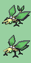

# No.0329 超音波幼虫

超音波幼虫#0329

地面 龙

<table class="ib-t"><tr><th>全国图鉴号</th><td>0329</td></tr><tr><th>分类</th><td>震动</td></tr><tr><th>种族值合计</th><td>340</td></tr><tr><th>成长率</th><td>中慢</td></tr><tr><th>蛋组</th><td></td></tr><tr><th>雌性比例</th><td>无性别差异</td></tr><tr><th>捕获率</th><td>120</td></tr><tr><th>基础亲密</th><td>70（标准）</td></tr></table>

<a href="#stats">种族值</a><a href="#matchup">相性</a><a href="#ability">特性</a><a href="#moves">招式池</a><a href="#forms">形态</a>

会剧烈地振动翅膀来产生超音波。能用消化液来溶化昏迷的猎物。

## 种族值 {#stats}

<table class="statbar-t">
<tr><th>HP</th><td class="num">50</td><td>
<i style="width:25%;background:#63bb63"></i>
</td></tr>
<tr><th>攻击</th><td class="num">70</td><td>
<i style="width:35%;background:#e0b93c"></i>
</td></tr>
<tr><th>防御</th><td class="num">50</td><td>
<i style="width:25%;background:#d2794a"></i>
</td></tr>
<tr><th>特攻</th><td class="num">50</td><td>
<i style="width:25%;background:#45b8c8"></i>
</td></tr>
<tr><th>特防</th><td class="num">50</td><td>
<i style="width:25%;background:#5b7dc6"></i>
</td></tr>
<tr><th>速度</th><td class="num">70</td><td>
<i style="width:35%;background:#b467c4"></i>
</td></tr>
<tr class="total"><th>总和</th><td class="num">340</td><td>
<i style="width:100%;background:#8a97a8"></i>
</td></tr>
</table>

## 相性（防守侧） {#matchup}

| 倍率 | 攻击属性 |
|---|---|
| **4×** | 冰 |
| **2×** | 龙 |
| **1×** | 一般 地面 幽灵 恶 格斗 水 草 虫 超能力 钢 飞行 |
| **1/2×** | 岩石 毒 火 |
| **免疫** | 电 |

## 特性 {#ability}

| 槽位 | 特性 | 游戏内描述 |
|:---|:---|:---|
| 第一特性 | **[飘浮](../abilities/飘浮.md)** | 不会受地面属性招式攻击 |
| 第二特性 | **[飘浮](../abilities/飘浮.md)** | 不会受地面属性招式攻击 |
| 隐藏特性 | **[飘浮](../abilities/飘浮.md)** | 不会受地面属性招式攻击 |

## 招式池 {#moves}

本作可通过回忆系统获得的**全部合法招式**，共 **92** 个（按招式编号序）。

展开查看全部 92 个合法招式

起风、飞翔、泼沙、头锤、泰山压顶、猛撞、舍身冲撞、咬住、超音波、音爆、破坏光线、怪力、日光束、地震、地裂、挖洞、剧毒、电光一闪、模仿、刺耳声、影子分身、聚气、忍耐、高速星星、睡觉、岩崩、替身、打鼾、抓狂、守住、掷泥、逆鳞、沙暴、终极吸取、挺住、虚张声势、连斩、钢翼、迷人、梦话、报恩、迁怒、龙息、觉醒力量、龙卷风、大晴天、咬碎、碎岩、吵闹、热风、硬撑、蛮力、秘密之力、惊吓、空气利刃、岩石封锁、银色旋风、信号光束、流沙深渊、燕返、龙爪、泥巴射击、羽栖、自然之恩、佯攻、顺风、急速折返、空气之刃、虫鸣、龙之波动、龙之俯冲、大地之力、终极冲击、清除浓雾、流星群、尖石攻击、诱惑、隐形岩、虫咬、奇异之风、轮唱、虫之抵抗、重踏、龙尾、爆音波、密语、迎头一击、磨砺、深渊突刺、双翼、热沙大地、兆频虫噪

## 形态 {#forms}

无（本编号在本作只有一个可用形态）

<a href="../0328-大颚蚁/">← #0328 大颚蚁</a>
<a href="../">图鉴目录</a>
<a href="../0330-沙漠蜻蜓/">#0330 沙漠蜻蜓 →</a>

