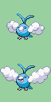

# No.0333 青绵鸟

青绵鸟#0333

一般 飞行

<table class="ib-t"><tr><th>全国图鉴号</th><td>0333</td></tr><tr><th>分类</th><td>绵鸟</td></tr><tr><th>种族值合计</th><td>310</td></tr><tr><th>成长率</th><td>杂乱</td></tr><tr><th>蛋组</th><td>飞行 · 龙</td></tr><tr><th>雌性比例</th><td>无性别差异</td></tr><tr><th>捕获率</th><td>255</td></tr><tr><th>基础亲密</th><td>70（标准）</td></tr></table>

<a href="#stats">种族值</a><a href="#matchup">相性</a><a href="#ability">特性</a><a href="#moves">招式池</a><a href="#forms">形态</a>

如果自己和周围不干净，就无法静下心来的性格。见到脏东西就会用羽毛擦掉。

## 种族值 {#stats}

<table class="statbar-t">
<tr><th>HP</th><td class="num">45</td><td>
<i style="width:22%;background:#63bb63"></i>
</td></tr>
<tr><th>攻击</th><td class="num">40</td><td>
<i style="width:20%;background:#e0b93c"></i>
</td></tr>
<tr><th>防御</th><td class="num">60</td><td>
<i style="width:30%;background:#d2794a"></i>
</td></tr>
<tr><th>特攻</th><td class="num">40</td><td>
<i style="width:20%;background:#45b8c8"></i>
</td></tr>
<tr><th>特防</th><td class="num">75</td><td>
<i style="width:38%;background:#5b7dc6"></i>
</td></tr>
<tr><th>速度</th><td class="num">50</td><td>
<i style="width:25%;background:#b467c4"></i>
</td></tr>
<tr class="total"><th>总和</th><td class="num">310</td><td>
<i style="width:100%;background:#8a97a8"></i>
</td></tr>
</table>

## 相性（防守侧） {#matchup}

| 倍率 | 攻击属性 |
|---|---|
| **2×** | 冰 岩石 电 |
| **1×** | 一般 恶 格斗 毒 水 火 超能力 钢 飞行 龙 |
| **1/2×** | 草 虫 |
| **免疫** | 地面 幽灵 |

## 特性 {#ability}

| 槽位 | 特性 | 游戏内描述 |
|:---|:---|:---|
| 第一特性 | **[自然回复](../abilities/自然回复.md)** | 被换下后治愈异常状态 |
| 隐藏特性 | **[无关天气](../abilities/无关天气.md)** | 任何天气的影响都会消失 |

## 招式池 {#moves}

本作可通过回忆系统获得的**全部合法招式**，共 **79** 个（按招式编号序）。

展开查看全部 79 个合法招式

飞翔、乱击、泰山压顶、猛撞、舍身冲撞、叫声、唱歌、白雾、冰冻光束、啄、日光束、剧毒、高速移动、愤怒、模仿、影子分身、黑雾、鹦鹉学舌、高速星星、食梦、神鸟猛击、睡觉、替身、小偷、打鼾、守住、掷泥、终焉之歌、逆鳞、挺住、点到为止、虚张声势、钢翼、迷人、梦话、治愈铃声、报恩、迁怒、神秘守护、龙息、追打、觉醒力量、龙卷风、求雨、大晴天、自我暗示、吵闹、热风、硬撑、帮助、蛮干、焕然一新、秘密之力、羽毛舞、巨声、惊吓、空气利刃、燕返、龙之舞、羽栖、自然之恩、啄食、顺风、力量互换、龙之波动、龙之俯冲、勇鸟猛攻、清除浓雾、诱惑、奇异之风、轮唱、回声、杂技、棉花防守、暴风、密语、双翼、起草、龙声鼓舞

## 形态 {#forms}

无（本编号在本作只有一个可用形态）

<a href="../0332-梦歌仙人掌/">← #0332 梦歌仙人掌</a>
<a href="../">图鉴目录</a>
<a href="../0334-七夕青鸟/">#0334 七夕青鸟 →</a>

