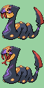

# No.0336 饭匙蛇

饭匙蛇#0336

毒

<table class="ib-t"><tr><th>全国图鉴号</th><td>0336</td></tr><tr><th>分类</th><td>牙蛇</td></tr><tr><th>种族值合计</th><td>458</td></tr><tr><th>成长率</th><td>浮动</td></tr><tr><th>蛋组</th><td>场地 · 龙</td></tr><tr><th>雌性比例</th><td>无性别差异</td></tr><tr><th>捕获率</th><td>90</td></tr><tr><th>基础亲密</th><td>70（标准）</td></tr></table>

<a href="#stats">种族值</a><a href="#matchup">相性</a><a href="#ability">特性</a><a href="#moves">招式池</a><a href="#forms">形态</a>

因为一直在用岩石打磨尾巴上的刀刃，所以异常锋利。和猫鼬斩是死对头。

## 种族值 {#stats}

<table class="statbar-t">
<tr><th>HP</th><td class="num">73</td><td>
<i style="width:36%;background:#63bb63"></i>
</td></tr>
<tr><th>攻击</th><td class="num">100</td><td>
<i style="width:50%;background:#e0b93c"></i>
</td></tr>
<tr><th>防御</th><td class="num">60</td><td>
<i style="width:30%;background:#d2794a"></i>
</td></tr>
<tr><th>特攻</th><td class="num">100</td><td>
<i style="width:50%;background:#45b8c8"></i>
</td></tr>
<tr><th>特防</th><td class="num">60</td><td>
<i style="width:30%;background:#5b7dc6"></i>
</td></tr>
<tr><th>速度</th><td class="num">65</td><td>
<i style="width:32%;background:#b467c4"></i>
</td></tr>
<tr class="total"><th>总和</th><td class="num">458</td><td>
<i style="width:100%;background:#8a97a8"></i>
</td></tr>
</table>

## 相性（防守侧） {#matchup}

| 倍率 | 攻击属性 |
|---|---|
| **2×** | 地面 超能力 |
| **1×** | 一般 冰 岩石 幽灵 恶 水 火 电 钢 飞行 龙 |
| **1/2×** | 格斗 毒 草 虫 |

## 特性 {#ability}

| 槽位 | 特性 | 游戏内描述 |
|:---|:---|:---|
| 第一特性 | **[蜕皮](../abilities/蜕皮.md)** | 有时会治愈异常状态 |
| 第二特性 | **[滑溜尾](../abilities/滑溜尾.md)** | 优先使用尾巴类招式 |
| 隐藏特性 | **[穿透](../abilities/穿透.md)** | 能穿透壁障或替身进行攻击 |

## 招式池 {#moves}

本作可通过回忆系统获得的**全部合法招式**，共 **106** 个（按招式编号序）。

展开查看全部 106 个合法招式

剑舞、绑紧、头锤、泰山压顶、紧束、猛撞、舍身冲撞、瞪眼、咬住、喷射火焰、破坏光线、怪力、地震、挖洞、剧毒、模仿、刺耳声、影子分身、黑雾、舌舔、高速星星、大蛇瞪眼、睡觉、替身、小偷、打鼾、咒术、绝处逢生、守住、可怕面孔、污泥炸弹、掷泥、终极吸取、挺住、虚张声势、连斩、迷人、梦话、报恩、迁怒、铁尾、觉醒力量、求雨、大晴天、咬碎、碎岩、蓄力、喷出、吞下、硬撑、挑衅、帮助、劈瓦、拍落、蛮干、化为己用、秘密之力、剧毒牙、毒尾、自然之恩、佯攻、以牙还牙、恶意追击、绞紧、胃液、惩罚、突袭、毒击、恶之波动、暗袭要害、水流尾、种子炸弹、十字剪、龙之波动、掉包、终极冲击、雷电牙、冰冻牙、火焰牙、意念头锤、垃圾射击、铁头、诱惑、毒液冲击、污泥波、盘蜷、酸液炸弹、轮唱、报仇、搏命、重踏、龙尾、大声咆哮、打嗝、密语、毒液陷阱、纠缠不休、深渊突刺、狂舞挥打、精神之牙、广域破坏、鳞射、爬击、泄愤、虫扑、起草

## 形态 {#forms}

无（本编号在本作只有一个可用形态）

<a href="../0335-猫鼬斩/">← #0335 猫鼬斩</a>
<a href="../">图鉴目录</a>
<a href="../0337-月石/">#0337 月石 →</a>

