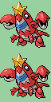

# No.0342 铁螯龙虾

铁螯龙虾#0342

水 恶

<table class="ib-t"><tr><th>全国图鉴号</th><td>0342</td></tr><tr><th>分类</th><td>流氓</td></tr><tr><th>种族值合计</th><td>468</td></tr><tr><th>成长率</th><td>浮动</td></tr><tr><th>蛋组</th><td>水中1 · 水中3</td></tr><tr><th>雌性比例</th><td>无性别差异</td></tr><tr><th>捕获率</th><td>155</td></tr><tr><th>基础亲密</th><td>70（标准）</td></tr></table>

<a href="#stats">种族值</a><a href="#matchup">相性</a><a href="#ability">特性</a><a href="#moves">招式池</a><a href="#forms">形态</a>

它是个粗暴的家伙。会用钳子把住在池塘里的其他宝可梦夹起来扔到外面去。

## 种族值 {#stats}

<table class="statbar-t">
<tr><th>HP</th><td class="num">63</td><td>
<i style="width:32%;background:#63bb63"></i>
</td></tr>
<tr><th>攻击</th><td class="num">120</td><td>
<i style="width:60%;background:#e0b93c"></i>
</td></tr>
<tr><th>防御</th><td class="num">85</td><td>
<i style="width:42%;background:#d2794a"></i>
</td></tr>
<tr><th>特攻</th><td class="num">90</td><td>
<i style="width:45%;background:#45b8c8"></i>
</td></tr>
<tr><th>特防</th><td class="num">55</td><td>
<i style="width:28%;background:#5b7dc6"></i>
</td></tr>
<tr><th>速度</th><td class="num">55</td><td>
<i style="width:28%;background:#b467c4"></i>
</td></tr>
<tr class="total"><th>总和</th><td class="num">468</td><td>
<i style="width:100%;background:#8a97a8"></i>
</td></tr>
</table>

## 相性（防守侧） {#matchup}

| 倍率 | 攻击属性 |
|---|---|
| **2×** | 格斗 电 草 虫 |
| **1×** | 一般 地面 岩石 毒 飞行 龙 |
| **1/2×** | 冰 幽灵 恶 水 火 钢 |
| **免疫** | 超能力 |

## 特性 {#ability}

| 槽位 | 特性 | 游戏内描述 |
|:---|:---|:---|
| 第一特性 | **[怪力钳](../abilities/怪力钳.md)** | 不会被对手降低攻击 |
| 第二特性 | **[硬壳盔甲](../abilities/硬壳盔甲.md)** | 对手的攻击不会击中要害 |
| 隐藏特性 | **[适应力](../abilities/适应力.md)** | 强化自身同属性的招式 |

## 招式池 {#moves}

本作可通过回忆系统获得的**全部合法招式**，共 **100** 个（按招式编号序）。

展开查看全部 100 个合法招式

极落钳、剑舞、居合劈、泰山压顶、猛撞、舍身冲撞、瞪眼、水枪、水炮、冲浪、冰冻光束、暴风雪、泡沫光线、破坏光线、双倍奉还、怪力、挖洞、剧毒、模仿、影子分身、变硬、攀瀑、高速星星、泡沫、蟹钳锤、睡觉、岩崩、劈开、替身、小偷、打鼾、怨恨、守住、可怕面孔、污泥炸弹、掷泥、冰冻之风、挺住、点到为止、虚张声势、连斩、迷人、梦话、报恩、迁怒、金属爪、觉醒力量、求雨、咬碎、原始之力、碎岩、潮旋、冰雹、硬撑、自然之力、挑衅、蛮力、报复、劈瓦、拍落、蛮干、秘密之力、潜水、玩泥巴、岩石封锁、浊流、燕返、铁壁、泥巴射击、玩水、龙之舞、水之波动、自然之恩、近身战、以牙还牙、投掷、王牌、恶之波动、暗袭要害、十字剪、掉包、终极冲击、诡计、雪崩、诱惑、水流喷射、二连击、磨爪、污泥波、轮唱、逐步击破、热水、报仇、贝壳刃、大声咆哮、密语、水流裂破、泄愤、泼冷水、硬压

## 形态 {#forms}

无（本编号在本作只有一个可用形态）

<a href="../0341-龙虾小兵/">← #0341 龙虾小兵</a>
<a href="../">图鉴目录</a>
<a href="../0343-天秤偶/">#0343 天秤偶 →</a>

