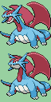

# No.0373 暴飞龙

暴飞龙#0373

龙 飞行

<table class="ib-t"><tr><th>全国图鉴号</th><td>0373</td></tr><tr><th>分类</th><td>龙</td></tr><tr><th>种族值合计</th><td>600</td></tr><tr><th>成长率</th><td>慢</td></tr><tr><th>蛋组</th><td>龙</td></tr><tr><th>雌性比例</th><td>无性别差异</td></tr><tr><th>捕获率</th><td>45</td></tr><tr><th>基础亲密</th><td>35</td></tr></table>

<a href="#stats">种族值</a><a href="#matchup">相性</a><a href="#ability">特性</a><a href="#moves">招式池</a><a href="#forms">形态</a>

因为不断祈求能够飞上天空，结果导致体内的细胞发生了变化，从而长出了翅膀。

## 种族值 {#stats}

<table class="statbar-t">
<tr><th>HP</th><td class="num">95</td><td>
<i style="width:48%;background:#63bb63"></i>
</td></tr>
<tr><th>攻击</th><td class="num">135</td><td>
<i style="width:68%;background:#e0b93c"></i>
</td></tr>
<tr><th>防御</th><td class="num">80</td><td>
<i style="width:40%;background:#d2794a"></i>
</td></tr>
<tr><th>特攻</th><td class="num">110</td><td>
<i style="width:55%;background:#45b8c8"></i>
</td></tr>
<tr><th>特防</th><td class="num">80</td><td>
<i style="width:40%;background:#5b7dc6"></i>
</td></tr>
<tr><th>速度</th><td class="num">100</td><td>
<i style="width:50%;background:#b467c4"></i>
</td></tr>
<tr class="total"><th>总和</th><td class="num">600</td><td>
<i style="width:100%;background:#8a97a8"></i>
</td></tr>
</table>

## 相性（防守侧） {#matchup}

| 倍率 | 攻击属性 |
|---|---|
| **4×** | 冰 |
| **2×** | 岩石 龙 |
| **1×** | 一般 幽灵 恶 毒 电 超能力 钢 飞行 |
| **1/2×** | 格斗 水 火 虫 |
| **1/4×** | 草 |
| **免疫** | 地面 |

## 特性 {#ability}

| 槽位 | 特性 | 游戏内描述 |
|:---|:---|:---|
| 第一特性 | **[威吓](../abilities/威吓.md)** | 出场时降低对手的攻击 |
| 隐藏特性 | **[自信过度](../abilities/自信过度.md)** | 打倒对手时攻击会提高 |

## 招式池 {#moves}

本作可通过回忆系统获得的**全部合法招式**，共 **100** 个（按招式编号序）。

展开查看全部 100 个合法招式

居合劈、飞翔、头锤、泰山压顶、猛撞、大闹一番、舍身冲撞、瞪眼、咬住、吼叫、火花、喷射火焰、水炮、破坏光线、怪力、龙之怒、火焰旋涡、地震、剧毒、愤怒、模仿、影子分身、变圆、聚气、大字爆炎、高速星星、火箭头锤、睡觉、岩崩、替身、打鼾、守住、可怕面孔、掷泥、逆鳞、挺住、滚动、虚张声势、连斩、钢翼、迷人、梦话、报恩、迁怒、龙息、铁尾、觉醒力量、龙卷风、求雨、大晴天、咬碎、碎岩、热风、硬撑、帮助、祈愿、劈瓦、焕然一新、秘密之力、巨声、空气利刃、岩石封锁、燕返、铁壁、龙爪、龙之舞、羽栖、自然之恩、顺风、水流尾、空气之刃、龙之波动、龙之俯冲、终极冲击、暗影爪、雷电牙、火焰牙、意念头锤、清除浓雾、流星群、铁头、尖石攻击、诱惑、奇异之风、磨爪、蓄能焰袭、轮唱、烧净、重踏、龙尾、暴风、密语、磨砺、狂舞挥打、精神之牙、广域破坏、鳞射、双翼、龙声鼓舞、豁出去

## 形态 {#forms}

无（本编号在本作只有一个可用形态）

<a href="../0372-甲壳龙/">← #0372 甲壳龙</a>
<a href="../">图鉴目录</a>
<a href="../0374-铁哑铃/">#0374 铁哑铃 →</a>

