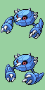

# No.0375 金属怪

金属怪#0375

钢 超能力

<table class="ib-t"><tr><th>全国图鉴号</th><td>0375</td></tr><tr><th>分类</th><td>铁爪</td></tr><tr><th>种族值合计</th><td>420</td></tr><tr><th>成长率</th><td>慢</td></tr><tr><th>蛋组</th><td>矿物</td></tr><tr><th>雌性比例</th><td>无性别差异</td></tr><tr><th>捕获率</th><td>3</td></tr><tr><th>基础亲密</th><td>35</td></tr></table>

<a href="#stats">种族值</a><a href="#matchup">相性</a><a href="#ability">特性</a><a href="#moves">招式池</a><a href="#forms">形态</a>

由2只铁哑铃组合而成。钢铁的身躯即使和喷气式飞机相撞也不会受伤。

## 种族值 {#stats}

<table class="statbar-t">
<tr><th>HP</th><td class="num">60</td><td>
<i style="width:30%;background:#63bb63"></i>
</td></tr>
<tr><th>攻击</th><td class="num">75</td><td>
<i style="width:38%;background:#e0b93c"></i>
</td></tr>
<tr><th>防御</th><td class="num">100</td><td>
<i style="width:50%;background:#d2794a"></i>
</td></tr>
<tr><th>特攻</th><td class="num">55</td><td>
<i style="width:28%;background:#45b8c8"></i>
</td></tr>
<tr><th>特防</th><td class="num">80</td><td>
<i style="width:40%;background:#5b7dc6"></i>
</td></tr>
<tr><th>速度</th><td class="num">50</td><td>
<i style="width:25%;background:#b467c4"></i>
</td></tr>
<tr class="total"><th>总和</th><td class="num">420</td><td>
<i style="width:100%;background:#8a97a8"></i>
</td></tr>
</table>

## 相性（防守侧） {#matchup}

| 倍率 | 攻击属性 |
|---|---|
| **2×** | 地面 火 |
| **1×** | 幽灵 恶 格斗 水 电 虫 |
| **1/2×** | 一般 冰 岩石 草 钢 飞行 龙 |
| **1/4×** | 超能力 |
| **免疫** | 毒 |

## 特性 {#ability}

| 槽位 | 特性 | 游戏内描述 |
|:---|:---|:---|
| 第一特性 | **[恒净之躯](../abilities/恒净之躯.md)** | 不会因为对手而被降低能力 |
| 隐藏特性 | **[轻金属](../abilities/轻金属.md)** | 自身的重量会减半 |

## 招式池 {#moves}

本作可通过回忆系统获得的**全部合法招式**，共 **93** 个（按招式编号序）。

展开查看全部 93 个合法招式

冰冻拳、雷电拳、居合劈、头锤、撞击、泰山压顶、猛撞、舍身冲撞、破坏光线、怪力、地震、剧毒、念力、精神强念、高速移动、模仿、影子分身、变圆、光墙、反射壁、玉石俱碎、高速星星、闪光、大爆炸、睡觉、岩崩、替身、打鼾、守住、可怕面孔、污泥炸弹、掷泥、冰冻之风、沙暴、挺住、滚动、虚张声势、连斩、梦话、报恩、迁怒、爆裂拳、追打、金属爪、觉醒力量、求雨、大晴天、自我暗示、暗影球、预知未来、碎岩、硬撑、真气拳、戏法、劈瓦、焕然一新、秘密之力、彗星拳、岩石封锁、宇宙力量、信号光束、燕返、铁壁、重力、奇迹之眼、臂锤、陀螺球、自然之恩、电磁飘浮、岩石打磨、终极冲击、子弹拳、精神利刃、意念头锤、加农光炮、铁头、磁铁炸弹、隐形岩、打草结、磨爪、精神冲击、意念移物、重磅冲撞、轮唱、交换场地、重踏、密语、增强拳、铁蹄光线、流星光束、起草、硬压、精神噪音

## 形态 {#forms}

无（本编号在本作只有一个可用形态）

<a href="../0374-铁哑铃/">← #0374 铁哑铃</a>
<a href="../">图鉴目录</a>
<a href="../0376-巨金怪/">#0376 巨金怪 →</a>

