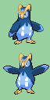

# No.0394 波皇子

波皇子#0394

水

<table class="ib-t"><tr><th>全国图鉴号</th><td>0394</td></tr><tr><th>分类</th><td>企鹅</td></tr><tr><th>种族值合计</th><td>405</td></tr><tr><th>成长率</th><td>中慢</td></tr><tr><th>蛋组</th><td>水中1 · 场地</td></tr><tr><th>雌性比例</th><td>无性别差异</td></tr><tr><th>捕获率</th><td>45</td></tr><tr><th>基础亲密</th><td>70（标准）</td></tr></table>

<a href="#stats">种族值</a><a href="#matchup">相性</a><a href="#ability">特性</a><a href="#moves">招式池</a><a href="#forms">形态</a>

每一只波皇子都认为自己是最了不起的，因此它们无法形成群体。

## 种族值 {#stats}

<table class="statbar-t">
<tr><th>HP</th><td class="num">64</td><td>
<i style="width:32%;background:#63bb63"></i>
</td></tr>
<tr><th>攻击</th><td class="num">66</td><td>
<i style="width:33%;background:#e0b93c"></i>
</td></tr>
<tr><th>防御</th><td class="num">68</td><td>
<i style="width:34%;background:#d2794a"></i>
</td></tr>
<tr><th>特攻</th><td class="num">81</td><td>
<i style="width:40%;background:#45b8c8"></i>
</td></tr>
<tr><th>特防</th><td class="num">76</td><td>
<i style="width:38%;background:#5b7dc6"></i>
</td></tr>
<tr><th>速度</th><td class="num">50</td><td>
<i style="width:25%;background:#b467c4"></i>
</td></tr>
<tr class="total"><th>总和</th><td class="num">405</td><td>
<i style="width:100%;background:#8a97a8"></i>
</td></tr>
</table>

## 相性（防守侧） {#matchup}

| 倍率 | 攻击属性 |
|---|---|
| **2×** | 电 草 |
| **1×** | 一般 地面 岩石 幽灵 恶 格斗 毒 虫 超能力 飞行 龙 |
| **1/2×** | 冰 水 火 钢 |

## 特性 {#ability}

| 槽位 | 特性 | 游戏内描述 |
|:---|:---|:---|
| 第一特性 | **[激流](../abilities/激流.md)** | HP低时强化水属性招式 |
| 隐藏特性 | **[好胜](../abilities/好胜.md)** | 被降低能力时大幅提高特攻 |

## 招式池 {#moves}

本作可通过回忆系统获得的**全部合法招式**，共 **93** 个（按招式编号序）。

展开查看全部 93 个合法招式

拍击、居合劈、头锤、乱击、撞击、猛撞、舍身冲撞、叫声、唱歌、超音波、白雾、水枪、水炮、冲浪、冰冻光束、暴风雪、泡沫光线、啄、啄钻、怪力、挖洞、剧毒、高速移动、影子分身、黑雾、忍耐、攀瀑、高速星星、泡沫、睡觉、替身、打鼾、抓狂、守住、掷泥、冰冻之风、挺住、撒娇、虚张声势、迷人、梦话、报恩、迁怒、金属爪、觉醒力量、求雨、自我暗示、碎岩、潮旋、冰雹、硬撑、帮助、劈瓦、哈欠、秘密之力、潜水、羽毛舞、玩泥巴、气象球、岩石封锁、信号光束、燕返、渴望、玩水、水之波动、羽栖、盐水、自然之恩、啄食、投掷、水流环、暗影爪、清除浓雾、诱惑、隐形岩、打草结、水流喷射、二连击、磨爪、轮唱、回声、热水、延后、水之誓约、自我激励、密语、嚣张、水流裂破、快速折返、三旋击、冰旋、雪景、泼冷水

## 形态 {#forms}

无（本编号在本作只有一个可用形态）

<a href="../0393-波加曼/">← #0393 波加曼</a>
<a href="../">图鉴目录</a>
<a href="../0395-帝王拿波/">#0395 帝王拿波 →</a>

