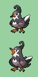

# No.0397 姆克鸟

姆克鸟#0397

一般 飞行

<table class="ib-t"><tr><th>全国图鉴号</th><td>0397</td></tr><tr><th>分类</th><td>椋鸟</td></tr><tr><th>种族值合计</th><td>340</td></tr><tr><th>成长率</th><td>中慢</td></tr><tr><th>蛋组</th><td>飞行</td></tr><tr><th>雌性比例</th><td>无性别差异</td></tr><tr><th>捕获率</th><td>120</td></tr><tr><th>基础亲密</th><td>70（标准）</td></tr></table>

<a href="#stats">种族值</a><a href="#matchup">相性</a><a href="#ability">特性</a><a href="#moves">招式池</a><a href="#forms">形态</a>

有组成庞大的团队来行动的习性。各个团队之间的争斗很激烈。

## 种族值 {#stats}

<table class="statbar-t">
<tr><th>HP</th><td class="num">55</td><td>
<i style="width:28%;background:#63bb63"></i>
</td></tr>
<tr><th>攻击</th><td class="num">75</td><td>
<i style="width:38%;background:#e0b93c"></i>
</td></tr>
<tr><th>防御</th><td class="num">50</td><td>
<i style="width:25%;background:#d2794a"></i>
</td></tr>
<tr><th>特攻</th><td class="num">40</td><td>
<i style="width:20%;background:#45b8c8"></i>
</td></tr>
<tr><th>特防</th><td class="num">40</td><td>
<i style="width:20%;background:#5b7dc6"></i>
</td></tr>
<tr><th>速度</th><td class="num">80</td><td>
<i style="width:40%;background:#b467c4"></i>
</td></tr>
<tr class="total"><th>总和</th><td class="num">340</td><td>
<i style="width:100%;background:#8a97a8"></i>
</td></tr>
</table>

## 相性（防守侧） {#matchup}

| 倍率 | 攻击属性 |
|---|---|
| **2×** | 冰 岩石 电 |
| **1×** | 一般 恶 格斗 毒 水 火 超能力 钢 飞行 龙 |
| **1/2×** | 草 虫 |
| **免疫** | 地面 幽灵 |

## 特性 {#ability}

| 槽位 | 特性 | 游戏内描述 |
|:---|:---|:---|
| 第一特性 | **[威吓](../abilities/威吓.md)** | 出场时降低对手的攻击 |
| 隐藏特性 | **[舍身](../abilities/舍身.md)** | 强化有反作用力伤害的招式 |

## 招式池 {#moves}

本作可通过回忆系统获得的**全部合法招式**，共 **72** 个（按招式编号序）。

展开查看全部 72 个合法招式

起风、翅膀攻击、吹飞、飞翔、泼沙、乱击、撞击、猛撞、舍身冲撞、叫声、啄、剧毒、高速移动、电光一闪、影子分身、鹦鹉学舌、高速星星、火箭头锤、神鸟猛击、睡觉、替身、小偷、打鼾、守住、掷泥、识破、看穿、挺住、虚张声势、钢翼、迷人、梦话、报恩、迁怒、追打、觉醒力量、龙卷风、求雨、大晴天、吵闹、热风、硬撑、帮助、报复、拍落、蛮干、秘密之力、羽毛舞、惊吓、空气利刃、燕返、羽栖、自然之恩、啄食、顺风、急速折返、空气之刃、真空波、勇鸟猛攻、终极冲击、清除浓雾、诱惑、奇异之风、轮唱、回声、杂技、报仇、搏命、自我激励、暴风、密语、双翼

## 形态 {#forms}

无（本编号在本作只有一个可用形态）

<a href="../0396-姆克儿/">← #0396 姆克儿</a>
<a href="../">图鉴目录</a>
<a href="../0398-姆克鹰/">#0398 姆克鹰 →</a>

