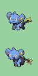

# No.0403 小猫怪

小猫怪#0403

电

<table class="ib-t"><tr><th>全国图鉴号</th><td>0403</td></tr><tr><th>分类</th><td>闪光</td></tr><tr><th>种族值合计</th><td>263</td></tr><tr><th>成长率</th><td>中慢</td></tr><tr><th>蛋组</th><td>场地</td></tr><tr><th>雌性比例</th><td>无性别差异</td></tr><tr><th>捕获率</th><td>235</td></tr><tr><th>基础亲密</th><td>70（标准）</td></tr></table>

<a href="#stats">种族值</a><a href="#matchup">相性</a><a href="#ability">特性</a><a href="#moves">招式池</a><a href="#forms">形态</a>

每当活动身体时，肌肉就会伸缩产生电。危机时刻，身体会发光。

## 种族值 {#stats}

<table class="statbar-t">
<tr><th>HP</th><td class="num">45</td><td>
<i style="width:22%;background:#63bb63"></i>
</td></tr>
<tr><th>攻击</th><td class="num">65</td><td>
<i style="width:32%;background:#e0b93c"></i>
</td></tr>
<tr><th>防御</th><td class="num">34</td><td>
<i style="width:17%;background:#d2794a"></i>
</td></tr>
<tr><th>特攻</th><td class="num">40</td><td>
<i style="width:20%;background:#45b8c8"></i>
</td></tr>
<tr><th>特防</th><td class="num">34</td><td>
<i style="width:17%;background:#5b7dc6"></i>
</td></tr>
<tr><th>速度</th><td class="num">45</td><td>
<i style="width:22%;background:#b467c4"></i>
</td></tr>
<tr class="total"><th>总和</th><td class="num">263</td><td>
<i style="width:100%;background:#8a97a8"></i>
</td></tr>
</table>

## 相性（防守侧） {#matchup}

| 倍率 | 攻击属性 |
|---|---|
| **2×** | 地面 |
| **1×** | 一般 冰 岩石 幽灵 恶 格斗 毒 水 火 草 虫 超能力 龙 |
| **1/2×** | 电 钢 飞行 |

## 特性 {#ability}

| 槽位 | 特性 | 游戏内描述 |
|:---|:---|:---|
| 第一特性 | **[斗争心](../abilities/斗争心.md)** | 对同性别对手变强反之变弱 |
| 第二特性 | **[威吓](../abilities/威吓.md)** | 出场时降低对手的攻击 |
| 隐藏特性 | **[毅力](../abilities/毅力.md)** | 异常状态时攻击会提高 |

## 招式池 {#moves}

本作可通过回忆系统获得的**全部合法招式**，共 **68** 个（按招式编号序）。

展开查看全部 68 个合法招式

二连踢、头锤、撞击、猛撞、舍身冲撞、瞪眼、咬住、吼叫、怪力、电击、十万伏特、电磁波、打雷、剧毒、电光一闪、影子分身、奇异之光、光墙、高速星星、闪光、睡觉、替身、小偷、打鼾、守住、可怕面孔、掷泥、挺住、虚张声势、电光、连斩、迷人、梦话、报恩、迁怒、铁尾、觉醒力量、求雨、大晴天、咬碎、硬撑、充电、帮助、秘密之力、假哭、信号光束、长嚎、电击波、自然之恩、电磁飘浮、暗袭要害、雷电牙、冰冻牙、火焰牙、放电、诱惑、充电光束、电球、轮唱、伏特替换、电网、疯狂伏特、大声咆哮、密语、怪异电波、电气场地、精神之牙、起草

## 形态 {#forms}

无（本编号在本作只有一个可用形态）

<a href="../0402-音箱蟀/">← #0402 音箱蟀</a>
<a href="../">图鉴目录</a>
<a href="../0404-勒克猫/">#0404 勒克猫 →</a>

