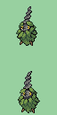

# No.0412 结草儿

结草儿#0412

虫

<table class="ib-t"><tr><th>全国图鉴号</th><td>0412</td></tr><tr><th>分类</th><td>蓑衣虫</td></tr><tr><th>种族值合计</th><td>224</td></tr><tr><th>成长率</th><td>中快</td></tr><tr><th>蛋组</th><td>虫</td></tr><tr><th>雌性比例</th><td>无性别差异</td></tr><tr><th>捕获率</th><td>120</td></tr><tr><th>基础亲密</th><td>70（标准）</td></tr></table>

<a href="#stats">种族值</a><a href="#matchup">相性</a><a href="#ability">特性</a><a href="#moves">招式池</a><a href="#forms">形态</a>

蓑衣只要稍有缺损，就会立即用身边的材料加以修补。蓑衣内的身体十分细瘦且畏惧寒冷。

## 种族值 {#stats}

<table class="statbar-t">
<tr><th>HP</th><td class="num">40</td><td>
<i style="width:20%;background:#63bb63"></i>
</td></tr>
<tr><th>攻击</th><td class="num">29</td><td>
<i style="width:14%;background:#e0b93c"></i>
</td></tr>
<tr><th>防御</th><td class="num">45</td><td>
<i style="width:22%;background:#d2794a"></i>
</td></tr>
<tr><th>特攻</th><td class="num">29</td><td>
<i style="width:14%;background:#45b8c8"></i>
</td></tr>
<tr><th>特防</th><td class="num">45</td><td>
<i style="width:22%;background:#5b7dc6"></i>
</td></tr>
<tr><th>速度</th><td class="num">36</td><td>
<i style="width:18%;background:#b467c4"></i>
</td></tr>
<tr class="total"><th>总和</th><td class="num">224</td><td>
<i style="width:100%;background:#8a97a8"></i>
</td></tr>
</table>

## 相性（防守侧） {#matchup}

| 倍率 | 攻击属性 |
|---|---|
| **2×** | 岩石 火 飞行 |
| **1×** | 一般 冰 幽灵 恶 毒 水 电 虫 超能力 钢 龙 |
| **1/2×** | 地面 格斗 草 |

## 特性 {#ability}

| 槽位 | 特性 | 游戏内描述 |
|:---|:---|:---|
| 第一特性 | **[蜕皮](../abilities/蜕皮.md)** | 有时会治愈异常状态 |
| 隐藏特性 | **[防尘](../abilities/防尘.md)** | 无视沙暴与粉末或孢子招式 |

## 招式池 {#moves}

本作可通过回忆系统获得的**全部合法招式**，共 **8** 个（按招式编号序）。

展开查看全部 8 个合法招式

撞击、吐丝、打鼾、守住、觉醒力量、虫咬、虫之抵抗、电网

## 形态 {#forms}

无（本编号在本作只有一个可用形态）

<a href="../0411-护城龙/">← #0411 护城龙</a>
<a href="../">图鉴目录</a>
<a href="../0413-结草贵妇/">#0413 结草贵妇 →</a>

