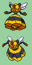

# No.0416 蜂女王

蜂女王#0416

虫 飞行

<table class="ib-t"><tr><th>全国图鉴号</th><td>0416</td></tr><tr><th>分类</th><td>蜂巢</td></tr><tr><th>种族值合计</th><td>474</td></tr><tr><th>成长率</th><td>中慢</td></tr><tr><th>蛋组</th><td>虫</td></tr><tr><th>雌性比例</th><td>无性别差异</td></tr><tr><th>捕获率</th><td>45</td></tr><tr><th>基础亲密</th><td>70（标准）</td></tr></table>

<a href="#stats">种族值</a><a href="#matchup">相性</a><a href="#ability">特性</a><a href="#moves">招式池</a><a href="#forms">形态</a>

躯体是孩子们的巢穴。释放出各种各样的费洛蒙，自由地控制孩子们。

## 种族值 {#stats}

<table class="statbar-t">
<tr><th>HP</th><td class="num">70</td><td>
<i style="width:35%;background:#63bb63"></i>
</td></tr>
<tr><th>攻击</th><td class="num">80</td><td>
<i style="width:40%;background:#e0b93c"></i>
</td></tr>
<tr><th>防御</th><td class="num">102</td><td>
<i style="width:51%;background:#d2794a"></i>
</td></tr>
<tr><th>特攻</th><td class="num">80</td><td>
<i style="width:40%;background:#45b8c8"></i>
</td></tr>
<tr><th>特防</th><td class="num">102</td><td>
<i style="width:51%;background:#5b7dc6"></i>
</td></tr>
<tr><th>速度</th><td class="num">40</td><td>
<i style="width:20%;background:#b467c4"></i>
</td></tr>
<tr class="total"><th>总和</th><td class="num">474</td><td>
<i style="width:100%;background:#8a97a8"></i>
</td></tr>
</table>

## 相性（防守侧） {#matchup}

| 倍率 | 攻击属性 |
|---|---|
| **4×** | 岩石 |
| **2×** | 冰 火 电 飞行 |
| **1×** | 一般 幽灵 恶 毒 水 超能力 钢 龙 |
| **1/2×** | 虫 |
| **1/4×** | 格斗 草 |
| **免疫** | 地面 |

## 特性 {#ability}

| 槽位 | 特性 | 游戏内描述 |
|:---|:---|:---|
| 第一特性 | **[压迫感](../abilities/压迫感.md)** | 减少对手使用招式的PP |
| 第二特性 | **[蜂蜜盔甲](../abilities/蜂蜜盔甲.md)** | 首次出场时，防御会提高 |
| 隐藏特性 | **[紧张感](../abilities/紧张感.md)** | 让对手紧张得无法食用树果 |

## 招式池 {#moves}

本作可通过回忆系统获得的**全部合法招式**，共 **94** 个（按招式编号序）。

展开查看全部 94 个合法招式

居合劈、起风、猛撞、毒针、飞弹针、破坏光线、吐丝、剧毒、高速移动、刺耳声、影子分身、自我再生、奇异之光、高速星星、闪光、乱抓、睡觉、劈开、替身、小偷、打鼾、绝处逢生、怨恨、守住、可怕面孔、污泥炸弹、掷泥、撒菱、同命、挺住、虚张声势、连斩、迷人、梦话、报恩、迁怒、追打、甜甜香气、觉醒力量、求雨、大晴天、围攻、吵闹、硬撑、挑衅、帮助、报复、蛮干、秘密之力、芳香治疗、空气利刃、银色旋风、信号光束、燕返、羽栖、自然之恩、顺风、急速折返、恶意追击、投掷、毒菱、空气之刃、十字剪、虫鸣、力量宝石、终极冲击、清除浓雾、十字毒刃、诱惑、虫咬、攻击指令、防御指令、回复指令、奇异之风、磨爪、毒液冲击、轮唱、祸不单行、延后、杂技、虫之抵抗、暴风、致命针刺、密语、纠缠不休、磨砺、花粉团、猛扑、爬击、双翼、力量转换、虫扑、精神噪音、硬铠冲撞

## 形态 {#forms}

无（本编号在本作只有一个可用形态）

<a href="../0415-三蜜蜂/">← #0415 三蜜蜂</a>
<a href="../">图鉴目录</a>
<a href="../0417-帕奇利兹/">#0417 帕奇利兹 →</a>

