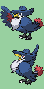

# No.0430 乌鸦头头

乌鸦头头#0430

恶 飞行

<table class="ib-t"><tr><th>全国图鉴号</th><td>0430</td></tr><tr><th>分类</th><td>大头目</td></tr><tr><th>种族值合计</th><td>505</td></tr><tr><th>成长率</th><td>中慢</td></tr><tr><th>蛋组</th><td>飞行</td></tr><tr><th>雌性比例</th><td>无性别差异</td></tr><tr><th>捕获率</th><td>30</td></tr><tr><th>基础亲密</th><td>35</td></tr></table>

<a href="#stats">种族值</a><a href="#matchup">相性</a><a href="#ability">特性</a><a href="#moves">招式池</a><a href="#forms">形态</a>

乌鸦头头低声鸣叫的话，黑暗鸦就会立即聚集起来，因此也被称为黑夜召唤者。

## 种族值 {#stats}

<table class="statbar-t">
<tr><th>HP</th><td class="num">100</td><td>
<i style="width:50%;background:#63bb63"></i>
</td></tr>
<tr><th>攻击</th><td class="num">125</td><td>
<i style="width:62%;background:#e0b93c"></i>
</td></tr>
<tr><th>防御</th><td class="num">52</td><td>
<i style="width:26%;background:#d2794a"></i>
</td></tr>
<tr><th>特攻</th><td class="num">105</td><td>
<i style="width:52%;background:#45b8c8"></i>
</td></tr>
<tr><th>特防</th><td class="num">52</td><td>
<i style="width:26%;background:#5b7dc6"></i>
</td></tr>
<tr><th>速度</th><td class="num">71</td><td>
<i style="width:36%;background:#b467c4"></i>
</td></tr>
<tr class="total"><th>总和</th><td class="num">505</td><td>
<i style="width:100%;background:#8a97a8"></i>
</td></tr>
</table>

## 相性（防守侧） {#matchup}

| 倍率 | 攻击属性 |
|---|---|
| **2×** | 冰 岩石 电 |
| **1×** | 一般 格斗 毒 水 火 虫 钢 飞行 龙 |
| **1/2×** | 幽灵 恶 草 |
| **免疫** | 地面 超能力 |

## 特性 {#ability}

| 槽位 | 特性 | 游戏内描述 |
|:---|:---|:---|
| 第一特性 | **[不眠](../abilities/不眠.md)** | 不会陷入睡眠状态 |
| 第二特性 | **[超幸运](../abilities/超幸运.md)** | 攻击容易击中对手的要害 |
| 隐藏特性 | **[自信过度](../abilities/自信过度.md)** | 打倒对手时攻击会提高 |

## 招式池 {#moves}

本作可通过回忆系统获得的**全部合法招式**，共 **99** 个（按招式编号序）。

展开查看全部 99 个合法招式

起风、翅膀攻击、吹飞、飞翔、猛撞、舍身冲撞、破坏光线、啄、啄钻、电磁波、剧毒、精神强念、黑夜魔影、刺耳声、影子分身、奇异之光、黑雾、鹦鹉学舌、高速星星、食梦、神鸟猛击、睡觉、替身、小偷、打鼾、怨恨、守住、可怕面孔、掷泥、终焉之歌、冰冻之风、挺住、虚张声势、钢翼、黑色目光、迷人、梦话、报恩、迁怒、追打、觉醒力量、龙卷风、求雨、大晴天、自我暗示、暗影球、吵闹、热风、无理取闹、吹捧、硬撑、挑衅、帮助、蛮力、蛮干、化为己用、秘密之力、羽毛舞、惊吓、空气利刃、燕返、冥想、羽栖、自然之恩、啄食、顺风、急速折返、以牙还牙、恶意追击、查封、精神转移、惩罚、突袭、恶之波动、暗袭要害、空气之刃、勇鸟猛攻、终极冲击、诡计、清除浓雾、诱惑、奇异之风、移花接木、轮唱、祸不单行、烧净、延后、杂技、报仇、暴风、大声咆哮、密语、泄愤、双翼、泼冷水、复仇、精神噪音、暗之乱舞、夜之舞

## 形态 {#forms}

无（本编号在本作只有一个可用形态）

<a href="../0429-梦妖魔/">← #0429 梦妖魔</a>
<a href="../">图鉴目录</a>
<a href="../0431-魅力喵/">#0431 魅力喵 →</a>

