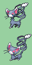

# No.0431 魅力喵

魅力喵#0431

一般

<table class="ib-t"><tr><th>全国图鉴号</th><td>0431</td></tr><tr><th>分类</th><td>装乖</td></tr><tr><th>种族值合计</th><td>310</td></tr><tr><th>成长率</th><td>快</td></tr><tr><th>蛋组</th><td>场地</td></tr><tr><th>雌性比例</th><td>无性别差异</td></tr><tr><th>捕获率</th><td>190</td></tr><tr><th>基础亲密</th><td>70（标准）</td></tr></table>

<a href="#stats">种族值</a><a href="#matchup">相性</a><a href="#ability">特性</a><a href="#moves">招式池</a><a href="#forms">形态</a>

一不称心，就会竖起爪子。但偶尔会从喉咙里发出声响来撒娇，这样的性格很受部分人喜爱。

## 种族值 {#stats}

<table class="statbar-t">
<tr><th>HP</th><td class="num">49</td><td>
<i style="width:24%;background:#63bb63"></i>
</td></tr>
<tr><th>攻击</th><td class="num">55</td><td>
<i style="width:28%;background:#e0b93c"></i>
</td></tr>
<tr><th>防御</th><td class="num">42</td><td>
<i style="width:21%;background:#d2794a"></i>
</td></tr>
<tr><th>特攻</th><td class="num">42</td><td>
<i style="width:21%;background:#45b8c8"></i>
</td></tr>
<tr><th>特防</th><td class="num">37</td><td>
<i style="width:18%;background:#5b7dc6"></i>
</td></tr>
<tr><th>速度</th><td class="num">85</td><td>
<i style="width:42%;background:#b467c4"></i>
</td></tr>
<tr class="total"><th>总和</th><td class="num">310</td><td>
<i style="width:100%;background:#8a97a8"></i>
</td></tr>
</table>

## 相性（防守侧） {#matchup}

| 倍率 | 攻击属性 |
|---|---|
| **2×** | 格斗 |
| **1×** | 一般 冰 地面 岩石 恶 毒 水 火 电 草 虫 超能力 钢 飞行 龙 |
| **免疫** | 幽灵 |

## 特性 {#ability}

| 槽位 | 特性 | 游戏内描述 |
|:---|:---|:---|
| 第一特性 | **[柔软](../abilities/柔软.md)** | 不会变为麻痹状态 |
| 第二特性 | **[我行我素](../abilities/我行我素.md)** | 不会被混乱或威吓 |
| 隐藏特性 | **[锐利目光](../abilities/锐利目光.md)** | 命中率不会被降低 |

## 招式池 {#moves}

本作可通过回忆系统获得的**全部合法招式**，共 **75** 个（按招式编号序）。

展开查看全部 75 个合法招式

抓、居合劈、泼沙、头锤、撞击、舍身冲撞、摇尾巴、咬住、叫声、十万伏特、打雷、挖洞、剧毒、催眠术、电光一闪、影子分身、高速星星、食梦、闪光、乱抓、睡觉、愤怒门牙、劈开、替身、小偷、打鼾、抓狂、守住、掷泥、挺住、撒娇、虚张声势、连斩、迷人、梦话、报恩、迁怒、铁尾、觉醒力量、求雨、大晴天、自我暗示、暗影球、击掌奇袭、无理取闹、硬撑、挑衅、借助、拍落、化为己用、秘密之力、巨声、假哭、燕返、渴望、电击波、水之波动、唤醒巴掌、自然之恩、急速折返、以牙还牙、恶意追击、珍藏、突袭、暗袭要害、诡计、暗影爪、诱惑、磨爪、移花接木、轮唱、回声、报仇、自我激励、密语

## 形态 {#forms}

无（本编号在本作只有一个可用形态）

<a href="../0430-乌鸦头头/">← #0430 乌鸦头头</a>
<a href="../">图鉴目录</a>
<a href="../0432-东施喵/">#0432 东施喵 →</a>

