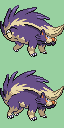

# No.0435 坦克臭鼬

坦克臭鼬#0435

毒 恶

<table class="ib-t"><tr><th>全国图鉴号</th><td>0435</td></tr><tr><th>分类</th><td>臭鼬</td></tr><tr><th>种族值合计</th><td>479</td></tr><tr><th>成长率</th><td>中快</td></tr><tr><th>蛋组</th><td>场地</td></tr><tr><th>雌性比例</th><td>无性别差异</td></tr><tr><th>捕获率</th><td>60</td></tr><tr><th>基础亲密</th><td>70（标准）</td></tr></table>

<a href="#stats">种族值</a><a href="#matchup">相性</a><a href="#ability">特性</a><a href="#moves">招式池</a><a href="#forms">形态</a>

会从尾巴尖端喷出奇臭无比的液体进行攻击，然而面对来自上方的攻击时会不知所措。

## 种族值 {#stats}

<table class="statbar-t">
<tr><th>HP</th><td class="num">103</td><td>
<i style="width:52%;background:#63bb63"></i>
</td></tr>
<tr><th>攻击</th><td class="num">93</td><td>
<i style="width:46%;background:#e0b93c"></i>
</td></tr>
<tr><th>防御</th><td class="num">67</td><td>
<i style="width:34%;background:#d2794a"></i>
</td></tr>
<tr><th>特攻</th><td class="num">71</td><td>
<i style="width:36%;background:#45b8c8"></i>
</td></tr>
<tr><th>特防</th><td class="num">61</td><td>
<i style="width:30%;background:#5b7dc6"></i>
</td></tr>
<tr><th>速度</th><td class="num">84</td><td>
<i style="width:42%;background:#b467c4"></i>
</td></tr>
<tr class="total"><th>总和</th><td class="num">479</td><td>
<i style="width:100%;background:#8a97a8"></i>
</td></tr>
</table>

## 相性（防守侧） {#matchup}

| 倍率 | 攻击属性 |
|---|---|
| **2×** | 地面 |
| **1×** | 一般 冰 岩石 格斗 水 火 电 虫 钢 飞行 龙 |
| **1/2×** | 幽灵 恶 毒 草 |
| **免疫** | 超能力 |

## 特性 {#ability}

| 槽位 | 特性 | 游戏内描述 |
|:---|:---|:---|
| 第一特性 | **[恶臭](../abilities/恶臭.md)** | 释放臭味，有时会使对手畏缩 |
| 第二特性 | **[引爆](../abilities/引爆.md)** | 昏厥时伤害接触的对手 |
| 隐藏特性 | **[锐利目光](../abilities/锐利目光.md)** | 命中率不会被降低 |

## 招式池 {#moves}

本作可通过回忆系统获得的**全部合法招式**，共 **99** 个（按招式编号序）。

展开查看全部 99 个合法招式

抓、居合劈、头锤、撞击、泰山压顶、猛撞、舍身冲撞、瞪眼、咬住、吼叫、喷射火焰、破坏光线、怪力、火焰旋涡、挖洞、剧毒、刺耳声、影子分身、烟幕、黑雾、聚气、浊雾、大字爆炎、高速星星、毒瓦斯、大爆炸、乱抓、睡觉、愤怒门牙、劈开、替身、小偷、打鼾、守住、可怕面孔、污泥炸弹、掷泥、挺住、虚张声势、连斩、迷人、梦话、报恩、迁怒、追打、铁尾、觉醒力量、求雨、大晴天、咬碎、暗影球、碎岩、无理取闹、临别礼物、硬撑、挑衅、帮助、拍落、蛮干、化为己用、秘密之力、惊吓、毒尾、自然之恩、佯攻、以牙还牙、恶意追击、惩罚、突袭、毒菱、毒击、恶之波动、暗袭要害、终极冲击、诡计、暗影爪、清除浓雾、垃圾射击、诱惑、磨爪、毒液冲击、烈焰溅射、污泥波、酸液炸弹、移花接木、轮唱、祸不单行、烧净、扫尾拍打、大声咆哮、打嗝、密语、毒液陷阱、深渊突刺、妒火、泄愤、腐蚀气体、起草、豁出去

## 形态 {#forms}

无（本编号在本作只有一个可用形态）

<a href="../0434-臭鼬噗/">← #0434 臭鼬噗</a>
<a href="../">图鉴目录</a>
<a href="../0436-铜镜怪/">#0436 铜镜怪 →</a>

