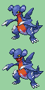

# No.0444 尖牙陆鲨

尖牙陆鲨#0444

龙 地面

<table class="ib-t"><tr><th>全国图鉴号</th><td>0444</td></tr><tr><th>分类</th><td>洞穴</td></tr><tr><th>种族值合计</th><td>410</td></tr><tr><th>成长率</th><td>慢</td></tr><tr><th>蛋组</th><td>怪兽 · 龙</td></tr><tr><th>雌性比例</th><td>无性别差异</td></tr><tr><th>捕获率</th><td>45</td></tr><tr><th>基础亲密</th><td>70（标准）</td></tr></table>

<a href="#stats">种族值</a><a href="#matchup">相性</a><a href="#ability">特性</a><a href="#moves">招式池</a><a href="#forms">形态</a>

最喜欢闪闪发光的东西，所以会把在洞窟里找到的宝贝都积存到自己的巢穴中。

## 种族值 {#stats}

<table class="statbar-t">
<tr><th>HP</th><td class="num">68</td><td>
<i style="width:34%;background:#63bb63"></i>
</td></tr>
<tr><th>攻击</th><td class="num">90</td><td>
<i style="width:45%;background:#e0b93c"></i>
</td></tr>
<tr><th>防御</th><td class="num">65</td><td>
<i style="width:32%;background:#d2794a"></i>
</td></tr>
<tr><th>特攻</th><td class="num">50</td><td>
<i style="width:25%;background:#45b8c8"></i>
</td></tr>
<tr><th>特防</th><td class="num">55</td><td>
<i style="width:28%;background:#5b7dc6"></i>
</td></tr>
<tr><th>速度</th><td class="num">82</td><td>
<i style="width:41%;background:#b467c4"></i>
</td></tr>
<tr class="total"><th>总和</th><td class="num">410</td><td>
<i style="width:100%;background:#8a97a8"></i>
</td></tr>
</table>

## 相性（防守侧） {#matchup}

| 倍率 | 攻击属性 |
|---|---|
| **4×** | 冰 |
| **2×** | 龙 |
| **1×** | 一般 地面 幽灵 恶 格斗 水 草 虫 超能力 钢 飞行 |
| **1/2×** | 岩石 毒 火 |
| **免疫** | 电 |

## 特性 {#ability}

| 槽位 | 特性 | 游戏内描述 |
|:---|:---|:---|
| 第一特性 | **[沙隐](../abilities/沙隐.md)** | 沙暴时，闪避率会提高 |
| 隐藏特性 | **[粗糙皮肤](../abilities/粗糙皮肤.md)** | 受到攻击时弄伤接触的对手 |

## 招式池 {#moves}

本作可通过回忆系统获得的**全部合法招式**，共 **84** 个（按招式编号序）。

展开查看全部 84 个合法招式

剑舞、居合劈、泼沙、头锤、撞击、泰山压顶、猛撞、大闹一番、舍身冲撞、咬住、吼叫、喷射火焰、怪力、龙之怒、地震、挖洞、剧毒、影子分身、大字爆炎、高速星星、睡觉、岩崩、劈开、替身、打鼾、守住、可怕面孔、掷泥、撒菱、逆鳞、沙暴、挺住、点到为止、虚张声势、连斩、迷人、梦话、报恩、迁怒、龙息、铁尾、金属爪、觉醒力量、龙卷风、求雨、大晴天、咬碎、碎岩、硬撑、帮助、劈瓦、秘密之力、岩石封锁、流沙深渊、燕返、龙爪、泥巴射击、自然之恩、毒击、龙之波动、龙之俯冲、力量宝石、大地之力、暗影爪、雷电牙、火焰牙、攀岩、流星群、铁头、尖石攻击、诱惑、隐形岩、磨爪、轮唱、烧净、重踏、龙尾、二连劈、密语、磨砺、广域破坏、鳞射、热沙大地、龙声鼓舞

## 形态 {#forms}

无（本编号在本作只有一个可用形态）

<a href="../0443-圆陆鲨/">← #0443 圆陆鲨</a>
<a href="../">图鉴目录</a>
<a href="../0445-烈咬陆鲨/">#0445 烈咬陆鲨 →</a>

