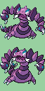

# No.0452 龙王蝎

龙王蝎#0452

毒 恶

<table class="ib-t"><tr><th>全国图鉴号</th><td>0452</td></tr><tr><th>分类</th><td>蝎怪</td></tr><tr><th>种族值合计</th><td>500</td></tr><tr><th>成长率</th><td>慢</td></tr><tr><th>蛋组</th><td>虫 · 水中3</td></tr><tr><th>雌性比例</th><td>无性别差异</td></tr><tr><th>捕获率</th><td>45</td></tr><tr><th>基础亲密</th><td>70（标准）</td></tr></table>

<a href="#stats">种族值</a><a href="#matchup">相性</a><a href="#ability">特性</a><a href="#moves">招式池</a><a href="#forms">形态</a>

双臂的钩爪有着能把汽车扯成废铁的破坏力。会从钩爪的前端放出毒素。

## 种族值 {#stats}

<table class="statbar-t">
<tr><th>HP</th><td class="num">70</td><td>
<i style="width:35%;background:#63bb63"></i>
</td></tr>
<tr><th>攻击</th><td class="num">90</td><td>
<i style="width:45%;background:#e0b93c"></i>
</td></tr>
<tr><th>防御</th><td class="num">110</td><td>
<i style="width:55%;background:#d2794a"></i>
</td></tr>
<tr><th>特攻</th><td class="num">60</td><td>
<i style="width:30%;background:#45b8c8"></i>
</td></tr>
<tr><th>特防</th><td class="num">75</td><td>
<i style="width:38%;background:#5b7dc6"></i>
</td></tr>
<tr><th>速度</th><td class="num">95</td><td>
<i style="width:48%;background:#b467c4"></i>
</td></tr>
<tr class="total"><th>总和</th><td class="num">500</td><td>
<i style="width:100%;background:#8a97a8"></i>
</td></tr>
</table>

## 相性（防守侧） {#matchup}

| 倍率 | 攻击属性 |
|---|---|
| **2×** | 地面 |
| **1×** | 一般 冰 岩石 格斗 水 火 电 虫 钢 飞行 龙 |
| **1/2×** | 幽灵 恶 毒 草 |
| **免疫** | 超能力 |

## 特性 {#ability}

| 槽位 | 特性 | 游戏内描述 |
|:---|:---|:---|
| 第一特性 | **[战斗盔甲](../abilities/战斗盔甲.md)** | 不会被攻击击中要害 |
| 第二特性 | **[狙击手](../abilities/狙击手.md)** | 击中要害时，威力提升 |
| 隐藏特性 | **[锐利目光](../abilities/锐利目光.md)** | 命中率不会被降低 |

## 招式池 {#moves}

本作可通过回忆系统获得的**全部合法招式**，共 **96** 个（按招式编号序）。

展开查看全部 96 个合法招式

剑舞、居合劈、吹飞、泼沙、头锤、毒针、双针、飞弹针、瞪眼、咬住、吼叫、破坏光线、怪力、地震、挖洞、剧毒、高速移动、刺耳声、影子分身、奇异之光、汲取、闪光、睡觉、岩崩、劈开、替身、小偷、打鼾、守住、可怕面孔、污泥炸弹、掷泥、挺住、点到为止、虚张声势、连斩、迷人、梦话、报恩、迁怒、追打、铁尾、觉醒力量、求雨、大晴天、咬碎、暗影球、碎岩、无理取闹、硬撑、挑衅、劈瓦、拍落、秘密之力、剧毒牙、岩石封锁、流沙深渊、燕返、铁壁、毒尾、自然之恩、点穴、以牙还牙、恶意追击、投掷、毒菱、毒击、恶之波动、暗袭要害、水流尾、十字剪、虫鸣、终极冲击、雷电牙、冰冻牙、火焰牙、攀岩、十字毒刃、诱惑、虫咬、磨爪、毒液冲击、轮唱、报仇、虫之抵抗、重踏、大声咆哮、致命针刺、密语、毒液陷阱、纠缠不休、深渊突刺、狂舞挥打、跺脚、爬击、泄愤

## 形态 {#forms}

无（本编号在本作只有一个可用形态）

<a href="../0451-钳尾蝎/">← #0451 钳尾蝎</a>
<a href="../">图鉴目录</a>
<a href="../0453-不良蛙/">#0453 不良蛙 →</a>

