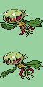

# No.0455 尖牙笼

尖牙笼#0455

草

<table class="ib-t"><tr><th>全国图鉴号</th><td>0455</td></tr><tr><th>分类</th><td>捕虫</td></tr><tr><th>种族值合计</th><td>454</td></tr><tr><th>成长率</th><td>慢</td></tr><tr><th>蛋组</th><td>植物</td></tr><tr><th>雌性比例</th><td>无性别差异</td></tr><tr><th>捕获率</th><td>200</td></tr><tr><th>基础亲密</th><td>70（标准）</td></tr></table>

<a href="#stats">种族值</a><a href="#matchup">相性</a><a href="#ability">特性</a><a href="#moves">招式池</a><a href="#forms">形态</a>

先用甜香的唾液引诱猎物，然后用大颚大口地嚼。要花1整天吃掉猎物。

## 种族值 {#stats}

<table class="statbar-t">
<tr><th>HP</th><td class="num">74</td><td>
<i style="width:37%;background:#63bb63"></i>
</td></tr>
<tr><th>攻击</th><td class="num">100</td><td>
<i style="width:50%;background:#e0b93c"></i>
</td></tr>
<tr><th>防御</th><td class="num">72</td><td>
<i style="width:36%;background:#d2794a"></i>
</td></tr>
<tr><th>特攻</th><td class="num">90</td><td>
<i style="width:45%;background:#45b8c8"></i>
</td></tr>
<tr><th>特防</th><td class="num">72</td><td>
<i style="width:36%;background:#5b7dc6"></i>
</td></tr>
<tr><th>速度</th><td class="num">46</td><td>
<i style="width:23%;background:#b467c4"></i>
</td></tr>
<tr class="total"><th>总和</th><td class="num">454</td><td>
<i style="width:100%;background:#8a97a8"></i>
</td></tr>
</table>

## 相性（防守侧） {#matchup}

| 倍率 | 攻击属性 |
|---|---|
| **2×** | 冰 毒 火 虫 飞行 |
| **1×** | 一般 岩石 幽灵 恶 格斗 超能力 钢 龙 |
| **1/2×** | 地面 水 电 草 |

## 特性 {#ability}

| 槽位 | 特性 | 游戏内描述 |
|:---|:---|:---|
| 第一特性 | **[飘浮](../abilities/飘浮.md)** | 不会受地面属性招式攻击 |

## 招式池 {#moves}

本作可通过回忆系统获得的**全部合法招式**，共 **71** 个（按招式编号序）。

展开查看全部 71 个合法招式

剑舞、居合劈、绑紧、摔打、藤鞭、咬住、破坏光线、吸取、寄生种子、生长、飞叶快刀、日光束、麻痹粉、催眠粉、剧毒、影子分身、汲取、闪光、睡觉、替身、小偷、打鼾、守住、污泥炸弹、掷泥、终极吸取、挺住、虚张声势、连斩、迷人、梦话、报恩、迁怒、甜甜香气、光合作用、觉醒力量、大晴天、咬碎、蓄力、喷出、吞下、硬撑、自然之力、扎根、拍落、秘密之力、摇晃舞、草笛、种子机关枪、魔法叶、自然之恩、以牙还牙、投掷、绞紧、胃液、烦恼种子、种子炸弹、能量球、终极冲击、清除浓雾、强力鞭打、诱惑、打草结、虫咬、愤怒粉、酸液炸弹、轮唱、青草搅拌器、密语、纠缠不休、深渊突刺

## 形态 {#forms}

无（本编号在本作只有一个可用形态）

<a href="../0454-毒骷蛙/">← #0454 毒骷蛙</a>
<a href="../">图鉴目录</a>
<a href="../0456-荧光鱼/">#0456 荧光鱼 →</a>

