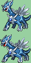

# No.0483 帝牙卢卡

帝牙卢卡#0483

钢 龙

<table class="ib-t"><tr><th>全国图鉴号</th><td>0483</td></tr><tr><th>分类</th><td>时间</td></tr><tr><th>种族值合计</th><td>680</td></tr><tr><th>成长率</th><td>慢</td></tr><tr><th>蛋组</th><td>未发现</td></tr><tr><th>雌性比例</th><td>无性别差异</td></tr><tr><th>捕获率</th><td>3</td></tr><tr><th>基础亲密</th><td>0</td></tr></table>

<a href="#stats">种族值</a><a href="#matchup">相性</a><a href="#ability">特性</a><a href="#moves">招式池</a><a href="#forms">形态</a>

由于帝牙卢卡的诞生，时间才开始流动。是有着这样传说的宝可梦。

## 种族值 {#stats}

<table class="statbar-t">
<tr><th>HP</th><td class="num">100</td><td>
<i style="width:50%;background:#63bb63"></i>
</td></tr>
<tr><th>攻击</th><td class="num">120</td><td>
<i style="width:60%;background:#e0b93c"></i>
</td></tr>
<tr><th>防御</th><td class="num">120</td><td>
<i style="width:60%;background:#d2794a"></i>
</td></tr>
<tr><th>特攻</th><td class="num">150</td><td>
<i style="width:75%;background:#45b8c8"></i>
</td></tr>
<tr><th>特防</th><td class="num">100</td><td>
<i style="width:50%;background:#5b7dc6"></i>
</td></tr>
<tr><th>速度</th><td class="num">90</td><td>
<i style="width:45%;background:#b467c4"></i>
</td></tr>
<tr class="total"><th>总和</th><td class="num">680</td><td>
<i style="width:100%;background:#8a97a8"></i>
</td></tr>
</table>

## 相性（防守侧） {#matchup}

| 倍率 | 攻击属性 |
|---|---|
| **2×** | 地面 格斗 |
| **1×** | 冰 火 龙 |
| **1/2×** | 一般 岩石 幽灵 恶 水 电 虫 超能力 钢 飞行 |
| **1/4×** | 草 |
| **免疫** | 毒 |

## 特性 {#ability}

| 槽位 | 特性 | 游戏内描述 |
|:---|:---|:---|
| 第一特性 | **[压迫感](../abilities/压迫感.md)** | 减少对手使用招式的PP |
| 隐藏特性 | **[心灵感应](../abilities/心灵感应.md)** | 闪避己方的招式伤害 |

## 招式池 {#moves}

本作可通过回忆系统获得的**全部合法招式**，共 **91** 个（按招式编号序）。

展开查看全部 91 个合法招式

居合劈、头锤、泰山压顶、猛撞、吼叫、喷射火焰、冰冻光束、暴风雪、破坏光线、怪力、十万伏特、电磁波、打雷、地震、剧毒、影子分身、大字爆炎、高速星星、闪光、睡觉、岩崩、劈开、替身、打鼾、守住、可怕面孔、掷泥、逆鳞、沙暴、挺住、虚张声势、连斩、梦话、报恩、迁怒、神秘守护、龙息、铁尾、金属爪、觉醒力量、龙卷风、求雨、大晴天、自我暗示、原始之力、碎岩、硬撑、戏法、劈瓦、秘密之力、巨声、过热、岩石封锁、金属音、燕返、铁壁、龙爪、健美、电击波、重力、自然之恩、金属爆炸、回复封锁、电磁飘浮、波导弹、龙之波动、力量宝石、真气弹、大地之力、终极冲击、暗影爪、加农光炮、戏法空间、流星群、铁头、尖石攻击、隐形岩、时光咆哮、磨爪、重磅冲撞、轮唱、回声、烧净、重踏、龙尾、密语、跺脚、扑击、广域破坏、铁蹄光线、鳞射

## 形态 {#forms}

无（本编号在本作只有一个可用形态）

<a href="../0482-亚克诺姆/">← #0482 亚克诺姆</a>
<a href="../">图鉴目录</a>
<a href="../0484-帕路奇亚/">#0484 帕路奇亚 →</a>

