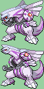

# No.0484 帕路奇亚

帕路奇亚#0484

水 龙

<table class="ib-t"><tr><th>全国图鉴号</th><td>0484</td></tr><tr><th>分类</th><td>空间</td></tr><tr><th>种族值合计</th><td>680</td></tr><tr><th>成长率</th><td>慢</td></tr><tr><th>蛋组</th><td>未发现</td></tr><tr><th>雌性比例</th><td>无性别差异</td></tr><tr><th>捕获率</th><td>3</td></tr><tr><th>基础亲密</th><td>0</td></tr></table>

<a href="#stats">种族值</a><a href="#matchup">相性</a><a href="#ability">特性</a><a href="#moves">招式池</a><a href="#forms">形态</a>

据说居住在平行排列的空间狭缝中，是出现在神话中的宝可梦。

## 种族值 {#stats}

<table class="statbar-t">
<tr><th>HP</th><td class="num">90</td><td>
<i style="width:45%;background:#63bb63"></i>
</td></tr>
<tr><th>攻击</th><td class="num">120</td><td>
<i style="width:60%;background:#e0b93c"></i>
</td></tr>
<tr><th>防御</th><td class="num">100</td><td>
<i style="width:50%;background:#d2794a"></i>
</td></tr>
<tr><th>特攻</th><td class="num">150</td><td>
<i style="width:75%;background:#45b8c8"></i>
</td></tr>
<tr><th>特防</th><td class="num">120</td><td>
<i style="width:60%;background:#5b7dc6"></i>
</td></tr>
<tr><th>速度</th><td class="num">100</td><td>
<i style="width:50%;background:#b467c4"></i>
</td></tr>
<tr class="total"><th>总和</th><td class="num">680</td><td>
<i style="width:100%;background:#8a97a8"></i>
</td></tr>
</table>

## 相性（防守侧） {#matchup}

| 倍率 | 攻击属性 |
|---|---|
| **2×** | 龙 |
| **1×** | 一般 冰 地面 岩石 幽灵 恶 格斗 毒 电 草 虫 超能力 飞行 |
| **1/2×** | 钢 |
| **1/4×** | 水 火 |

## 特性 {#ability}

| 槽位 | 特性 | 游戏内描述 |
|:---|:---|:---|
| 第一特性 | **[压迫感](../abilities/压迫感.md)** | 减少对手使用招式的PP |
| 隐藏特性 | **[心灵感应](../abilities/心灵感应.md)** | 闪避己方的招式伤害 |

## 招式池 {#moves}

本作可通过回忆系统获得的**全部合法招式**，共 **97** 个（按招式编号序）。

展开查看全部 97 个合法招式

居合劈、头锤、泰山压顶、猛撞、吼叫、喷射火焰、水炮、冲浪、冰冻光束、暴风雪、破坏光线、怪力、十万伏特、电磁波、打雷、地震、剧毒、影子分身、大字爆炎、攀瀑、高速星星、睡觉、岩崩、劈开、替身、打鼾、守住、可怕面孔、掷泥、冰冻之风、逆鳞、沙暴、挺住、虚张声势、连斩、梦话、报恩、迁怒、神秘守护、龙息、觉醒力量、龙卷风、求雨、大晴天、自我暗示、原始之力、碎岩、潮旋、冰雹、硬撑、真气拳、戏法、劈瓦、秘密之力、潜水、巨声、岩石封锁、燕返、龙爪、健美、电击波、水之波动、重力、盐水、自然之恩、投掷、回复封锁、水流环、波导弹、水流尾、龙之波动、力量宝石、真气弹、大地之力、终极冲击、雪崩、暗影爪、戏法空间、流星群、尖石攻击、亚空裂斩、磨爪、重磅冲撞、轮唱、回声、烧净、重踏、龙尾、密语、跺脚、水流裂破、扑击、广域破坏、鳞射、双翼、雪景、泼冷水

## 形态 {#forms}

无（本编号在本作只有一个可用形态）

<a href="../0483-帝牙卢卡/">← #0483 帝牙卢卡</a>
<a href="../">图鉴目录</a>
<a href="../0485-席多蓝恩/">#0485 席多蓝恩 →</a>

