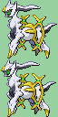

# No.0493 阿尔宙斯

阿尔宙斯#0493

一般

<table class="ib-t"><tr><th>全国图鉴号</th><td>0493</td></tr><tr><th>分类</th><td>创造</td></tr><tr><th>种族值合计</th><td>720</td></tr><tr><th>成长率</th><td>慢</td></tr><tr><th>蛋组</th><td>未发现</td></tr><tr><th>雌性比例</th><td>无性别差异</td></tr><tr><th>捕获率</th><td>3</td></tr><tr><th>基础亲密</th><td>0</td></tr></table>

<a href="#stats">种族值</a><a href="#matchup">相性</a><a href="#ability">特性</a><a href="#moves">招式池</a><a href="#forms">形态</a>

在神话里，它被描述为宇宙尚未存在时，就诞生的最早的宝可梦。

## 种族值 {#stats}

<table class="statbar-t">
<tr><th>HP</th><td class="num">120</td><td>
<i style="width:60%;background:#63bb63"></i>
</td></tr>
<tr><th>攻击</th><td class="num">120</td><td>
<i style="width:60%;background:#e0b93c"></i>
</td></tr>
<tr><th>防御</th><td class="num">120</td><td>
<i style="width:60%;background:#d2794a"></i>
</td></tr>
<tr><th>特攻</th><td class="num">120</td><td>
<i style="width:60%;background:#45b8c8"></i>
</td></tr>
<tr><th>特防</th><td class="num">120</td><td>
<i style="width:60%;background:#5b7dc6"></i>
</td></tr>
<tr><th>速度</th><td class="num">120</td><td>
<i style="width:60%;background:#b467c4"></i>
</td></tr>
<tr class="total"><th>总和</th><td class="num">720</td><td>
<i style="width:100%;background:#8a97a8"></i>
</td></tr>
</table>

## 相性（防守侧） {#matchup}

| 倍率 | 攻击属性 |
|---|---|
| **2×** | 格斗 |
| **1×** | 一般 冰 地面 岩石 恶 毒 水 火 电 草 虫 超能力 钢 飞行 龙 |
| **免疫** | 幽灵 |

## 特性 {#ability}

| 槽位 | 特性 | 游戏内描述 |
|:---|:---|:---|
| 第一特性 | **[多属性](../abilities/多属性.md)** | 属性会根据持有的石板改变 |

## 招式池 {#moves}

本作可通过回忆系统获得的**全部合法招式**，共 **172** 个（按招式编号序）。

展开查看全部 172 个合法招式

剑舞、居合劈、飞翔、头锤、泰山压顶、猛撞、舍身冲撞、吼叫、喷射火焰、水炮、冲浪、冰冻光束、暴风雪、破坏光线、地球上投、怪力、日光束、十万伏特、电磁波、打雷、地震、剧毒、念力、精神强念、高速移动、电光一闪、影子分身、自我再生、奇异之光、光墙、反射壁、大字爆炎、攀瀑、高速星星、食梦、闪光、睡觉、岩崩、替身、打鼾、守住、可怕面孔、污泥炸弹、掷泥、终焉之歌、冰冻之风、逆鳞、沙暴、终极吸取、挺住、虚张声势、连斩、梦话、报恩、迁怒、神秘守护、铁尾、觉醒力量、龙卷风、求雨、大晴天、自我暗示、神速、原始之力、暗影球、预知未来、碎岩、潮旋、热风、冰雹、磷火、硬撑、挑衅、戏法、魔法反射、回收利用、劈瓦、封印、焕然一新、秘密之力、潜水、巨声、过热、岩石封锁、银色旋风、宇宙力量、信号光束、神通力、种子机关枪、燕返、铁壁、龙爪、健美、魔法叶、冥想、龙之舞、电击波、水之波动、重力、治愈之愿、盐水、自然之恩、顺风、以牙还牙、惩罚、珍藏、闪焰冲锋、波导弹、毒击、恶之波动、水流尾、空气之刃、十字剪、虫鸣、龙之波动、力量宝石、真气弹、能量球、大地之力、终极冲击、雪崩、暗影爪、意念头锤、加农光炮、攀岩、清除浓雾、戏法空间、流星群、垃圾射击、铁头、尖石攻击、隐形岩、打草结、制裁光砾、充电光束、时光咆哮、亚空裂斩、奇异之风、暗影潜袭、磨爪、精神冲击、意念移物、重磅冲撞、酸液炸弹、移花接木、轮唱、回声、辅助力量、祸不单行、烧净、延后、报仇、重踏、龙尾、自我激励、疯狂伏特、暴风、大声咆哮、潜灵奇袭、密语、魔法火焰、电气场地、磨砺、跺脚、水流裂破、扑击、铁蹄光线、流星光束、热沙大地、起草、泼冷水、闪电强袭

## 形态 {#forms}

无（本编号在本作只有一个可用形态）

<a href="../0492-谢米/">← #0492 谢米</a>
<a href="../">图鉴目录</a>
<a href="../0494-比克提尼/">#0494 比克提尼 →</a>

