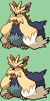

# No.0508 长毛狗

长毛狗#0508

一般

<table class="ib-t"><tr><th>全国图鉴号</th><td>0508</td></tr><tr><th>分类</th><td>宽大</td></tr><tr><th>种族值合计</th><td>500</td></tr><tr><th>成长率</th><td>中慢</td></tr><tr><th>蛋组</th><td>场地</td></tr><tr><th>雌性比例</th><td>无性别差异</td></tr><tr><th>捕获率</th><td>45</td></tr><tr><th>基础亲密</th><td>70（标准）</td></tr></table>

<a href="#stats">种族值</a><a href="#matchup">相性</a><a href="#ability">特性</a><a href="#moves">招式池</a><a href="#forms">形态</a>

如果被它长长的体毛包裹着，就会变得温暖又舒适，即使是在冬天的山上也能淡定地度过一晚。

## 种族值 {#stats}

<table class="statbar-t">
<tr><th>HP</th><td class="num">85</td><td>
<i style="width:42%;background:#63bb63"></i>
</td></tr>
<tr><th>攻击</th><td class="num">110</td><td>
<i style="width:55%;background:#e0b93c"></i>
</td></tr>
<tr><th>防御</th><td class="num">90</td><td>
<i style="width:45%;background:#d2794a"></i>
</td></tr>
<tr><th>特攻</th><td class="num">45</td><td>
<i style="width:22%;background:#45b8c8"></i>
</td></tr>
<tr><th>特防</th><td class="num">90</td><td>
<i style="width:45%;background:#5b7dc6"></i>
</td></tr>
<tr><th>速度</th><td class="num">80</td><td>
<i style="width:40%;background:#b467c4"></i>
</td></tr>
<tr class="total"><th>总和</th><td class="num">500</td><td>
<i style="width:100%;background:#8a97a8"></i>
</td></tr>
</table>

## 相性（防守侧） {#matchup}

| 倍率 | 攻击属性 |
|---|---|
| **2×** | 格斗 |
| **1×** | 一般 冰 地面 岩石 恶 毒 水 火 电 草 虫 超能力 钢 飞行 龙 |
| **免疫** | 幽灵 |

## 特性 {#ability}

| 槽位 | 特性 | 游戏内描述 |
|:---|:---|:---|
| 第一特性 | **[威吓](../abilities/威吓.md)** | 出场时降低对手的攻击 |
| 第二特性 | **[拨沙](../abilities/拨沙.md)** | 沙暴天气时，速度会提高 |
| 隐藏特性 | **[胆量](../abilities/胆量.md)** | 招式可击中幽灵并无视威吓 |

## 招式池 {#moves}

本作可通过回忆系统获得的**全部合法招式**，共 **65** 个（按招式编号序）。

展开查看全部 65 个合法招式

泼沙、撞击、猛撞、瞪眼、咬住、吼叫、冲浪、破坏光线、怪力、十万伏特、电磁波、打雷、挖洞、剧毒、影子分身、舌舔、睡觉、替身、打鼾、绝处逢生、守住、掷泥、挺住、撒娇、虚张声势、迷人、梦话、报恩、迁怒、追打、觉醒力量、求雨、大晴天、咬碎、暗影球、碎岩、吵闹、硬撑、帮助、蛮力、哈欠、秘密之力、巨声、气味侦测、岩石封锁、燕返、长嚎、渴望、电击波、以牙还牙、珍藏、终极冲击、雷电牙、冰冻牙、火焰牙、铁头、您先请、轮唱、报仇、自我激励、疯狂伏特、大声咆哮、密语、精神之牙、跺脚

## 形态 {#forms}

无（本编号在本作只有一个可用形态）

<a href="../0507-哈约克/">← #0507 哈约克</a>
<a href="../">图鉴目录</a>
<a href="../0509-扒手猫/">#0509 扒手猫 →</a>

