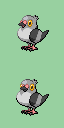

# No.0519 豆豆鸽

豆豆鸽#0519

一般 飞行

<table class="ib-t"><tr><th>全国图鉴号</th><td>0519</td></tr><tr><th>分类</th><td>小鸽</td></tr><tr><th>种族值合计</th><td>264</td></tr><tr><th>成长率</th><td>中慢</td></tr><tr><th>蛋组</th><td>飞行</td></tr><tr><th>雌性比例</th><td>无性别差异</td></tr><tr><th>捕获率</th><td>255</td></tr><tr><th>基础亲密</th><td>70（标准）</td></tr></table>

<a href="#stats">种族值</a><a href="#matchup">相性</a><a href="#ability">特性</a><a href="#moves">招式池</a><a href="#forms">形态</a>

生活在街道上的宝可梦。因为不怎么怕人，所以会大量聚集在公园或广场。

## 种族值 {#stats}

<table class="statbar-t">
<tr><th>HP</th><td class="num">50</td><td>
<i style="width:25%;background:#63bb63"></i>
</td></tr>
<tr><th>攻击</th><td class="num">55</td><td>
<i style="width:28%;background:#e0b93c"></i>
</td></tr>
<tr><th>防御</th><td class="num">50</td><td>
<i style="width:25%;background:#d2794a"></i>
</td></tr>
<tr><th>特攻</th><td class="num">36</td><td>
<i style="width:18%;background:#45b8c8"></i>
</td></tr>
<tr><th>特防</th><td class="num">30</td><td>
<i style="width:15%;background:#5b7dc6"></i>
</td></tr>
<tr><th>速度</th><td class="num">43</td><td>
<i style="width:22%;background:#b467c4"></i>
</td></tr>
<tr class="total"><th>总和</th><td class="num">264</td><td>
<i style="width:100%;background:#8a97a8"></i>
</td></tr>
</table>

## 相性（防守侧） {#matchup}

| 倍率 | 攻击属性 |
|---|---|
| **2×** | 冰 岩石 电 |
| **1×** | 一般 恶 格斗 毒 水 火 超能力 钢 飞行 龙 |
| **1/2×** | 草 虫 |
| **免疫** | 地面 幽灵 |

## 特性 {#ability}

| 槽位 | 特性 | 游戏内描述 |
|:---|:---|:---|
| 第一特性 | **[健壮胸肌](../abilities/健壮胸肌.md)** | 不会受到防御降低的效果 |
| 第二特性 | **[超幸运](../abilities/超幸运.md)** | 攻击容易击中对手的要害 |
| 隐藏特性 | **[斗争心](../abilities/斗争心.md)** | 对同性别对手变强反之变弱 |

## 招式池 {#moves}

本作可通过回忆系统获得的**全部合法招式**，共 **52** 个（按招式编号序）。

展开查看全部 52 个合法招式

旋风刀、起风、飞翔、瞪眼、叫声、剧毒、催眠术、高速移动、电光一闪、影子分身、聚气、高速星星、神鸟猛击、睡觉、替身、打鼾、守住、看穿、挺住、虚张声势、钢翼、迷人、梦话、报恩、迁怒、晨光、觉醒力量、求雨、大晴天、吵闹、热风、硬撑、挑衅、祈愿、秘密之力、羽毛舞、空气利刃、燕返、羽栖、啄食、顺风、急速折返、幸运咒语、暗袭要害、空气之刃、清除浓雾、轮唱、回声、传递礼物、自我激励、密语、双翼

## 形态 {#forms}

无（本编号在本作只有一个可用形态）

<a href="../0518-梦梦蚀/">← #0518 梦梦蚀</a>
<a href="../">图鉴目录</a>
<a href="../0520-咕咕鸽/">#0520 咕咕鸽 →</a>

