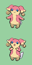

# No.0531 差不多娃娃

差不多娃娃#0531

一般

<table class="ib-t"><tr><th>全国图鉴号</th><td>0531</td></tr><tr><th>分类</th><td>听力</td></tr><tr><th>种族值合计</th><td>445</td></tr><tr><th>成长率</th><td>快</td></tr><tr><th>蛋组</th><td>妖精</td></tr><tr><th>雌性比例</th><td>无性别差异</td></tr><tr><th>捕获率</th><td>255</td></tr><tr><th>基础亲密</th><td>70（标准）</td></tr></table>

<a href="#stats">种族值</a><a href="#matchup">相性</a><a href="#ability">特性</a><a href="#moves">招式池</a><a href="#forms">形态</a>

用耳朵上的触角碰到对方的话，就能通过心跳声了解对方的身体状况和情绪。

## 种族值 {#stats}

<table class="statbar-t">
<tr><th>HP</th><td class="num">103</td><td>
<i style="width:52%;background:#63bb63"></i>
</td></tr>
<tr><th>攻击</th><td class="num">60</td><td>
<i style="width:30%;background:#e0b93c"></i>
</td></tr>
<tr><th>防御</th><td class="num">86</td><td>
<i style="width:43%;background:#d2794a"></i>
</td></tr>
<tr><th>特攻</th><td class="num">60</td><td>
<i style="width:30%;background:#45b8c8"></i>
</td></tr>
<tr><th>特防</th><td class="num">86</td><td>
<i style="width:43%;background:#5b7dc6"></i>
</td></tr>
<tr><th>速度</th><td class="num">50</td><td>
<i style="width:25%;background:#b467c4"></i>
</td></tr>
<tr class="total"><th>总和</th><td class="num">445</td><td>
<i style="width:100%;background:#8a97a8"></i>
</td></tr>
</table>

## 相性（防守侧） {#matchup}

| 倍率 | 攻击属性 |
|---|---|
| **2×** | 格斗 |
| **1×** | 一般 冰 地面 岩石 恶 毒 水 火 电 草 虫 超能力 钢 飞行 龙 |
| **免疫** | 幽灵 |

## 特性 {#ability}

| 槽位 | 特性 | 游戏内描述 |
|:---|:---|:---|
| 第一特性 | **[治愈之心](../abilities/治愈之心.md)** | 有时会治愈异常状态的同伴 |
| 第二特性 | **[再生力](../abilities/再生力.md)** | 换下后HP会少量回复 |
| 隐藏特性 | **[笨拙](../abilities/笨拙.md)** | 无法使用持有的道具 |

## 招式池 {#moves}

本作可通过回忆系统获得的**全部合法招式**，共 **105** 个（按招式编号序）。

展开查看全部 105 个合法招式

拍击、连环巴掌、百万吨重拳、火焰拳、冰冻拳、雷电拳、百万吨重踢、撞击、泰山压顶、猛撞、舍身冲撞、叫声、喷射火焰、冲浪、冰冻光束、暴风雪、破坏光线、踢倒、日光束、十万伏特、电磁波、打雷、挖洞、剧毒、精神强念、影子分身、光墙、反射壁、大字爆炎、瞬间失忆、食梦、闪光、睡觉、三重攻击、替身、打鼾、守住、天使之吻、冰冻之风、挺住、虚张声势、迷人、梦话、治愈铃声、报恩、礼物、迁怒、神秘守护、分担痛楚、再来一次、铁尾、觉醒力量、求雨、大晴天、自我暗示、暗影球、吵闹、硬撑、真气拳、帮助、扮演、祈愿、魔法反射、哈欠、拍落、特性互换、焕然一新、化为己用、秘密之力、巨声、信号光束、渴望、冥想、重力、治愈之愿、投掷、幸运咒语、珍藏、吸取拳、终极冲击、意念头锤、戏法空间、打草结、充电光束、精神冲击、意念移物、单纯光束、找伙伴、您先请、轮唱、回声、交换场地、治愈波动、烧净、报仇、传递礼物、自我激励、疯狂伏特、和睦相处、密语、增强拳、磨砺、深渊突刺、跺脚、生命水滴

## 形态 {#forms}

无（本编号在本作只有一个可用形态）

<a href="../0530-龙头地鼠/">← #0530 龙头地鼠</a>
<a href="../">图鉴目录</a>
<a href="../0532-搬运小匠/">#0532 搬运小匠 →</a>

