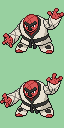

# No.0538 投摔鬼

投摔鬼#0538

格斗

<table class="ib-t"><tr><th>全国图鉴号</th><td>0538</td></tr><tr><th>分类</th><td>柔道</td></tr><tr><th>种族值合计</th><td>465</td></tr><tr><th>成长率</th><td>中快</td></tr><tr><th>蛋组</th><td>人型</td></tr><tr><th>雌性比例</th><td>无性别差异</td></tr><tr><th>捕获率</th><td>45</td></tr><tr><th>基础亲密</th><td>70（标准）</td></tr></table>

<a href="#stats">种族值</a><a href="#matchup">相性</a><a href="#ability">特性</a><a href="#moves">招式池</a><a href="#forms">形态</a>

如果遇到比自己大的对手，就忍不住极度想要投摔。变强后就会替换带子。

## 种族值 {#stats}

<table class="statbar-t">
<tr><th>HP</th><td class="num">120</td><td>
<i style="width:60%;background:#63bb63"></i>
</td></tr>
<tr><th>攻击</th><td class="num">100</td><td>
<i style="width:50%;background:#e0b93c"></i>
</td></tr>
<tr><th>防御</th><td class="num">85</td><td>
<i style="width:42%;background:#d2794a"></i>
</td></tr>
<tr><th>特攻</th><td class="num">30</td><td>
<i style="width:15%;background:#45b8c8"></i>
</td></tr>
<tr><th>特防</th><td class="num">85</td><td>
<i style="width:42%;background:#5b7dc6"></i>
</td></tr>
<tr><th>速度</th><td class="num">45</td><td>
<i style="width:22%;background:#b467c4"></i>
</td></tr>
<tr class="total"><th>总和</th><td class="num">465</td><td>
<i style="width:100%;background:#8a97a8"></i>
</td></tr>
</table>

## 相性（防守侧） {#matchup}

| 倍率 | 攻击属性 |
|---|---|
| **2×** | 超能力 飞行 |
| **1×** | 一般 冰 地面 幽灵 格斗 毒 水 火 电 草 钢 龙 |
| **1/2×** | 岩石 恶 虫 |

## 特性 {#ability}

| 槽位 | 特性 | 游戏内描述 |
|:---|:---|:---|
| 第一特性 | **[毅力](../abilities/毅力.md)** | 异常状态时攻击会提高 |
| 第二特性 | **[精神力](../abilities/精神力.md)** | 不会畏缩或被威吓影响 |
| 隐藏特性 | **[破格](../abilities/破格.md)** | 使用招式不受对手特性影响 |

## 招式池 {#moves}

本作可通过回忆系统获得的**全部合法招式**，共 **82** 个（按招式编号序）。

展开查看全部 82 个合法招式

百万吨重拳、火焰拳、冰冻拳、雷电拳、绑紧、百万吨重踢、泰山压顶、瞪眼、踢倒、地球上投、怪力、地震、挖洞、剧毒、影子分身、聚气、忍耐、火箭头锤、瞬间失忆、睡觉、岩崩、替身、打鼾、绝处逢生、守住、可怕面孔、逆鳞、挺住、滚动、虚张声势、迷人、梦话、报恩、迁怒、分担痛楚、爆裂拳、借力摔、觉醒力量、求雨、大晴天、碎岩、硬撑、真气拳、挑衅、帮助、蛮力、报复、劈瓦、拍落、秘密之力、岩石封锁、铁壁、挡路、健美、岩石爆击、近身战、以牙还牙、投掷、毒击、种子炸弹、真气弹、终极冲击、意念头锤、垃圾射击、铁头、尖石攻击、打草结、广域防守、山岚摔、下盘踢、轮唱、巴投、报仇、重踏、自我激励、掀榻榻米、密语、增强拳、磨砺、狂舞挥打、跺脚、指导

## 形态 {#forms}

无（本编号在本作只有一个可用形态）

<a href="../0537-蟾蜍王/">← #0537 蟾蜍王</a>
<a href="../">图鉴目录</a>
<a href="../0539-打击鬼/">#0539 打击鬼 →</a>

