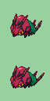

# No.0543 百足蜈蚣

百足蜈蚣#0543

虫 毒

<table class="ib-t"><tr><th>全国图鉴号</th><td>0543</td></tr><tr><th>分类</th><td>蜈蚣</td></tr><tr><th>种族值合计</th><td>260</td></tr><tr><th>成长率</th><td>中慢</td></tr><tr><th>蛋组</th><td>虫</td></tr><tr><th>雌性比例</th><td>无性别差异</td></tr><tr><th>捕获率</th><td>255</td></tr><tr><th>基础亲密</th><td>70（标准）</td></tr></table>

<a href="#stats">种族值</a><a href="#matchup">相性</a><a href="#ability">特性</a><a href="#moves">招式池</a><a href="#forms">形态</a>

会咬住对手施以剧毒。就连它的天敌大型鸟宝可梦也会身体麻痹，动弹不得。

## 种族值 {#stats}

<table class="statbar-t">
<tr><th>HP</th><td class="num">30</td><td>
<i style="width:15%;background:#63bb63"></i>
</td></tr>
<tr><th>攻击</th><td class="num">45</td><td>
<i style="width:22%;background:#e0b93c"></i>
</td></tr>
<tr><th>防御</th><td class="num">59</td><td>
<i style="width:30%;background:#d2794a"></i>
</td></tr>
<tr><th>特攻</th><td class="num">30</td><td>
<i style="width:15%;background:#45b8c8"></i>
</td></tr>
<tr><th>特防</th><td class="num">39</td><td>
<i style="width:20%;background:#5b7dc6"></i>
</td></tr>
<tr><th>速度</th><td class="num">57</td><td>
<i style="width:28%;background:#b467c4"></i>
</td></tr>
<tr class="total"><th>总和</th><td class="num">260</td><td>
<i style="width:100%;background:#8a97a8"></i>
</td></tr>
</table>

## 相性（防守侧） {#matchup}

| 倍率 | 攻击属性 |
|---|---|
| **2×** | 岩石 火 超能力 飞行 |
| **1×** | 一般 冰 地面 幽灵 恶 水 电 钢 龙 |
| **1/2×** | 毒 虫 |
| **1/4×** | 格斗 草 |

## 特性 {#ability}

| 槽位 | 特性 | 游戏内描述 |
|:---|:---|:---|
| 第一特性 | **[毒刺](../abilities/毒刺.md)** | 有时会让接触到的对手中毒 |
| 第二特性 | **[虫之预感](../abilities/虫之预感.md)** | HP低时强化虫属性招式 |
| 隐藏特性 | **[加速](../abilities/加速.md)** | 每一回合速度会变快 |

## 招式池 {#moves}

本作可通过回忆系统获得的**全部合法招式**，共 **54** 个（按招式编号序）。

展开查看全部 54 个合法招式

猛撞、舍身冲撞、毒针、双针、飞弹针、瞪眼、咬住、日光束、剧毒、高速移动、刺耳声、影子分身、变圆、睡觉、替身、打鼾、守住、污泥炸弹、撒菱、挺住、滚动、虚张声势、连斩、迷人、梦话、报恩、迁怒、追打、觉醒力量、大晴天、碎岩、硬撑、蛮力、蛮干、秘密之力、岩石封锁、信号光束、铁壁、毒尾、陀螺球、以牙还牙、毒菱、毒击、攀岩、虫咬、毒液冲击、轮唱、祸不单行、虫之抵抗、疯狂滚压、密语、毒液陷阱、纠缠不休、爬击

## 形态 {#forms}

无（本编号在本作只有一个可用形态）

<a href="../0542-保姆虫/">← #0542 保姆虫</a>
<a href="../">图鉴目录</a>
<a href="../0544-车轮球/">#0544 车轮球 →</a>

