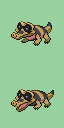

# No.0551 黑眼鳄

黑眼鳄#0551

地面 恶

<table class="ib-t"><tr><th>全国图鉴号</th><td>0551</td></tr><tr><th>分类</th><td>沙漠鳄鱼</td></tr><tr><th>种族值合计</th><td>292</td></tr><tr><th>成长率</th><td>中慢</td></tr><tr><th>蛋组</th><td>场地</td></tr><tr><th>雌性比例</th><td>无性别差异</td></tr><tr><th>捕获率</th><td>180</td></tr><tr><th>基础亲密</th><td>70（标准）</td></tr></table>

<a href="#stats">种族值</a><a href="#matchup">相性</a><a href="#ability">特性</a><a href="#moves">招式池</a><a href="#forms">形态</a>

在沙漠的沙子里生活。被太阳烘得暖暖的沙子会防止体温降低。

## 种族值 {#stats}

<table class="statbar-t">
<tr><th>HP</th><td class="num">50</td><td>
<i style="width:25%;background:#63bb63"></i>
</td></tr>
<tr><th>攻击</th><td class="num">72</td><td>
<i style="width:36%;background:#e0b93c"></i>
</td></tr>
<tr><th>防御</th><td class="num">35</td><td>
<i style="width:18%;background:#d2794a"></i>
</td></tr>
<tr><th>特攻</th><td class="num">35</td><td>
<i style="width:18%;background:#45b8c8"></i>
</td></tr>
<tr><th>特防</th><td class="num">35</td><td>
<i style="width:18%;background:#5b7dc6"></i>
</td></tr>
<tr><th>速度</th><td class="num">65</td><td>
<i style="width:32%;background:#b467c4"></i>
</td></tr>
<tr class="total"><th>总和</th><td class="num">292</td><td>
<i style="width:100%;background:#8a97a8"></i>
</td></tr>
</table>

## 相性（防守侧） {#matchup}

| 倍率 | 攻击属性 |
|---|---|
| **2×** | 冰 格斗 水 草 虫 |
| **1×** | 一般 地面 火 钢 飞行 龙 |
| **1/2×** | 岩石 幽灵 恶 毒 |
| **免疫** | 电 超能力 |

## 特性 {#ability}

| 槽位 | 特性 | 游戏内描述 |
|:---|:---|:---|
| 第一特性 | **[威吓](../abilities/威吓.md)** | 出场时降低对手的攻击 |
| 第二特性 | **[自信过度](../abilities/自信过度.md)** | 打倒对手时攻击会提高 |
| 隐藏特性 | **[愤怒穴位](../abilities/愤怒穴位.md)** | 要害被击中时攻击变为最大 |

## 招式池 {#moves}

本作可通过回忆系统获得的**全部合法招式**，共 **82** 个（按招式编号序）。

展开查看全部 82 个合法招式

居合劈、泼沙、撞击、泰山压顶、猛撞、大闹一番、舍身冲撞、瞪眼、咬住、吼叫、双倍奉还、地震、挖洞、剧毒、愤怒、影子分身、聚气、睡觉、岩崩、替身、小偷、打鼾、咒术、怨恨、守住、可怕面孔、污泥炸弹、掷泥、沙暴、挺住、虚张声势、黑色目光、迷人、梦话、报恩、迁怒、追打、铁尾、觉醒力量、咬碎、围攻、吵闹、无理取闹、硬撑、挑衅、帮助、劈瓦、化为己用、秘密之力、岩石封锁、流沙深渊、燕返、龙爪、泥巴射击、以牙还牙、恶意追击、查封、投掷、抢先一步、恶之波动、水流尾、大地之力、暗影爪、雷电牙、火焰牙、攀岩、尖石攻击、隐形岩、打草结、磨爪、移花接木、轮唱、烧净、报仇、重踏、大声咆哮、密语、嚣张、跺脚、爬击、泄愤、热沙大地

## 形态 {#forms}

无（本编号在本作只有一个可用形态）

<a href="../0550-野蛮鲈鱼/">← #0550 野蛮鲈鱼</a>
<a href="../">图鉴目录</a>
<a href="../0552-混混鳄/">#0552 混混鳄 →</a>

