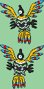

# No.0561 象征鸟

象征鸟#0561

超能力 飞行

<table class="ib-t"><tr><th>全国图鉴号</th><td>0561</td></tr><tr><th>分类</th><td>似鸟</td></tr><tr><th>种族值合计</th><td>490</td></tr><tr><th>成长率</th><td>中快</td></tr><tr><th>蛋组</th><td>飞行</td></tr><tr><th>雌性比例</th><td>无性别差异</td></tr><tr><th>捕获率</th><td>45</td></tr><tr><th>基础亲密</th><td>70（标准）</td></tr></table>

<a href="#stats">种族值</a><a href="#matchup">相性</a><a href="#ability">特性</a><a href="#moves">招式池</a><a href="#forms">形态</a>

古代都市的守护神。过去一直以相同路线巡视，警戒着入侵者。

## 种族值 {#stats}

<table class="statbar-t">
<tr><th>HP</th><td class="num">72</td><td>
<i style="width:36%;background:#63bb63"></i>
</td></tr>
<tr><th>攻击</th><td class="num">58</td><td>
<i style="width:29%;background:#e0b93c"></i>
</td></tr>
<tr><th>防御</th><td class="num">80</td><td>
<i style="width:40%;background:#d2794a"></i>
</td></tr>
<tr><th>特攻</th><td class="num">103</td><td>
<i style="width:52%;background:#45b8c8"></i>
</td></tr>
<tr><th>特防</th><td class="num">80</td><td>
<i style="width:40%;background:#5b7dc6"></i>
</td></tr>
<tr><th>速度</th><td class="num">97</td><td>
<i style="width:48%;background:#b467c4"></i>
</td></tr>
<tr class="total"><th>总和</th><td class="num">490</td><td>
<i style="width:100%;background:#8a97a8"></i>
</td></tr>
</table>

## 相性（防守侧） {#matchup}

| 倍率 | 攻击属性 |
|---|---|
| **2×** | 冰 岩石 幽灵 恶 电 |
| **1×** | 一般 毒 水 火 虫 钢 飞行 龙 |
| **1/2×** | 草 超能力 |
| **1/4×** | 格斗 |
| **免疫** | 地面 |

## 特性 {#ability}

| 槽位 | 特性 | 游戏内描述 |
|:---|:---|:---|
| 第一特性 | **[奇迹皮肤](../abilities/奇迹皮肤.md)** | 不易受到变化招式攻击 |
| 第二特性 | **[魔法防守](../abilities/魔法防守.md)** | 不会受到攻击以外的伤害 |
| 隐藏特性 | **[有色眼镜](../abilities/有色眼镜.md)** | 提升效果不好的招式威力 |

## 招式池 {#moves}

本作可通过回忆系统获得的**全部合法招式**，共 **81** 个（按招式编号序）。

展开查看全部 81 个合法招式

起风、吹飞、飞翔、冰冻光束、幻象光线、破坏光线、日光束、电磁波、剧毒、念力、精神强念、催眠术、影子分身、光墙、反射壁、鹦鹉学舌、高速星星、食梦、神鸟猛击、闪光、精神波、睡觉、替身、小偷、打鼾、守住、冰冻之风、挺住、虚张声势、钢翼、迷人、梦话、报恩、迁怒、神秘守护、觉醒力量、求雨、自我暗示、原始之力、暗影球、预知未来、热风、硬撑、戏法、魔法反射、特性互换、封印、秘密之力、空气利刃、宇宙力量、信号光束、燕返、冥想、电击波、重力、羽栖、奇迹之眼、啄食、顺风、精神转移、力量互换、恶之波动、空气之刃、能量球、终极冲击、精神利刃、意念头锤、加农光炮、清除浓雾、戏法空间、充电光束、精神冲击、意念移物、魔法空间、击落、同步干扰、轮唱、辅助力量、密语、速度互换、双翼

## 形态 {#forms}

无（本编号在本作只有一个可用形态）

<a href="../0560-头巾混混/">← #0560 头巾混混</a>
<a href="../">图鉴目录</a>
<a href="../0562-哭哭面具/">#0562 哭哭面具 →</a>

