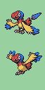

# No.0566 始祖小鸟

始祖小鸟#0566

岩石 飞行

<table class="ib-t"><tr><th>全国图鉴号</th><td>0566</td></tr><tr><th>分类</th><td>远古鸟</td></tr><tr><th>种族值合计</th><td>401</td></tr><tr><th>成长率</th><td>中快</td></tr><tr><th>蛋组</th><td>飞行 · 水中3</td></tr><tr><th>雌性比例</th><td>无性别差异</td></tr><tr><th>捕获率</th><td>45</td></tr><tr><th>基础亲密</th><td>70（标准）</td></tr></table>

<a href="#stats">种族值</a><a href="#matchup">相性</a><a href="#ability">特性</a><a href="#moves">招式池</a><a href="#forms">形态</a>

据说是鸟宝可梦的祖先。不能飞行，好像会在枝条间跳来跳去生活。

## 种族值 {#stats}

<table class="statbar-t">
<tr><th>HP</th><td class="num">55</td><td>
<i style="width:28%;background:#63bb63"></i>
</td></tr>
<tr><th>攻击</th><td class="num">112</td><td>
<i style="width:56%;background:#e0b93c"></i>
</td></tr>
<tr><th>防御</th><td class="num">45</td><td>
<i style="width:22%;background:#d2794a"></i>
</td></tr>
<tr><th>特攻</th><td class="num">74</td><td>
<i style="width:37%;background:#45b8c8"></i>
</td></tr>
<tr><th>特防</th><td class="num">45</td><td>
<i style="width:22%;background:#5b7dc6"></i>
</td></tr>
<tr><th>速度</th><td class="num">70</td><td>
<i style="width:35%;background:#b467c4"></i>
</td></tr>
<tr class="total"><th>总和</th><td class="num">401</td><td>
<i style="width:100%;background:#8a97a8"></i>
</td></tr>
</table>

## 相性（防守侧） {#matchup}

| 倍率 | 攻击属性 |
|---|---|
| **2×** | 冰 岩石 水 电 钢 |
| **1×** | 幽灵 恶 格斗 草 超能力 龙 |
| **1/2×** | 一般 毒 火 虫 飞行 |
| **免疫** | 地面 |

## 特性 {#ability}

| 槽位 | 特性 | 游戏内描述 |
|:---|:---|:---|
| 第一特性 | **[软弱](../abilities/软弱.md)** | HP低于1/3时，攻击特攻会减半 |

## 招式池 {#moves}

本作可通过回忆系统获得的**全部合法招式**，共 **75** 个（按招式编号序）。

展开查看全部 75 个合法招式

居合劈、翅膀攻击、大闹一番、瞪眼、咬住、吼叫、落石、地震、挖洞、剧毒、高速移动、电光一闪、影子分身、高速星星、睡觉、岩崩、替身、打鼾、守住、可怕面孔、沙暴、挺住、虚张声势、钢翼、迷人、梦话、报恩、迁怒、龙息、铁尾、觉醒力量、咬碎、原始之力、碎岩、吵闹、热风、无理取闹、硬撑、挑衅、拍落、蛮干、秘密之力、岩石封锁、燕返、铁壁、龙爪、弹跳、岩石爆击、羽栖、啄食、顺风、急速折返、恶意追击、岩石打磨、水流尾、龙之波动、大地之力、掉包、暗影爪、意念头锤、清除浓雾、尖石攻击、隐形岩、双刃头锤、磨爪、击落、轮唱、快速防守、交换场地、杂技、重踏、密语、流星光束、泄愤、双翼

## 形态 {#forms}

无（本编号在本作只有一个可用形态）

<a href="../0565-肋骨海龟/">← #0565 肋骨海龟</a>
<a href="../">图鉴目录</a>
<a href="../0567-始祖大鸟/">#0567 始祖大鸟 →</a>

