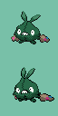

# No.0568 破破袋

破破袋#0568

毒

<table class="ib-t"><tr><th>全国图鉴号</th><td>0568</td></tr><tr><th>分类</th><td>垃圾袋</td></tr><tr><th>种族值合计</th><td>329</td></tr><tr><th>成长率</th><td>中快</td></tr><tr><th>蛋组</th><td>矿物</td></tr><tr><th>雌性比例</th><td>无性别差异</td></tr><tr><th>捕获率</th><td>190</td></tr><tr><th>基础亲密</th><td>70（标准）</td></tr></table>

<a href="#stats">种族值</a><a href="#matchup">相性</a><a href="#ability">特性</a><a href="#moves">招式池</a><a href="#forms">形态</a>

喜欢不卫生的地方。如果吸入它像打嗝那样吐出的瓦斯，会整整1个星期卧病不起。

## 种族值 {#stats}

<table class="statbar-t">
<tr><th>HP</th><td class="num">50</td><td>
<i style="width:25%;background:#63bb63"></i>
</td></tr>
<tr><th>攻击</th><td class="num">50</td><td>
<i style="width:25%;background:#e0b93c"></i>
</td></tr>
<tr><th>防御</th><td class="num">62</td><td>
<i style="width:31%;background:#d2794a"></i>
</td></tr>
<tr><th>特攻</th><td class="num">40</td><td>
<i style="width:20%;background:#45b8c8"></i>
</td></tr>
<tr><th>特防</th><td class="num">62</td><td>
<i style="width:31%;background:#5b7dc6"></i>
</td></tr>
<tr><th>速度</th><td class="num">65</td><td>
<i style="width:32%;background:#b467c4"></i>
</td></tr>
<tr class="total"><th>总和</th><td class="num">329</td><td>
<i style="width:100%;background:#8a97a8"></i>
</td></tr>
</table>

## 相性（防守侧） {#matchup}

| 倍率 | 攻击属性 |
|---|---|
| **2×** | 地面 超能力 |
| **1×** | 一般 冰 岩石 幽灵 恶 水 火 电 钢 飞行 龙 |
| **1/2×** | 格斗 毒 草 虫 |

## 特性 {#ability}

| 槽位 | 特性 | 游戏内描述 |
|:---|:---|:---|
| 第一特性 | **[恶臭](../abilities/恶臭.md)** | 释放臭味，有时会使对手畏缩 |
| 第二特性 | **[黏着](../abilities/黏着.md)** | 道具不会被对手夺走 |
| 隐藏特性 | **[引爆](../abilities/引爆.md)** | 昏厥时伤害接触的对手 |

## 招式池 {#moves}

本作可通过回忆系统获得的**全部合法招式**，共 **63** 个（按招式编号序）。

展开查看全部 63 个合法招式

拍击、连环巴掌、泼沙、头锤、猛撞、剧毒、影子分身、烟幕、黑雾、玉石俱碎、污泥攻击、瞬间失忆、毒瓦斯、大爆炸、睡觉、替身、小偷、打鼾、咒术、怨恨、守住、污泥炸弹、撒菱、终极吸取、挺住、滚动、虚张声势、迷人、梦话、报恩、迁怒、分担痛楚、觉醒力量、求雨、大晴天、蓄力、吞下、硬撑、回收利用、秘密之力、玩泥巴、种子机关枪、泥巴射击、岩石爆击、以牙还牙、毒菱、毒击、恶之波动、种子炸弹、吸取拳、垃圾射击、毒液冲击、身体轻量化、污泥波、酸液炸弹、轮唱、清除之烟、打嗝、密语、毒液陷阱、纠缠不休、狂舞挥打、腐蚀气体

## 形态 {#forms}

无（本编号在本作只有一个可用形态）

<a href="../0567-始祖大鸟/">← #0567 始祖大鸟</a>
<a href="../">图鉴目录</a>
<a href="../0569-灰尘山/">#0569 灰尘山 →</a>

