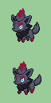

# No.0570 索罗亚

索罗亚#0570

恶

<table class="ib-t"><tr><th>全国图鉴号</th><td>0570</td></tr><tr><th>分类</th><td>恶狐</td></tr><tr><th>种族值合计</th><td>330</td></tr><tr><th>成长率</th><td>中慢</td></tr><tr><th>蛋组</th><td>场地</td></tr><tr><th>雌性比例</th><td>无性别差异</td></tr><tr><th>捕获率</th><td>75</td></tr><tr><th>基础亲密</th><td>70（标准）</td></tr></table>

<a href="#stats">种族值</a><a href="#matchup">相性</a><a href="#ability">特性</a><a href="#moves">招式池</a><a href="#forms">形态</a>

会幻化成人类或其他宝可梦。通过隐藏自己的本来面貌来保护自己不受危险侵害。

## 种族值 {#stats}

<table class="statbar-t">
<tr><th>HP</th><td class="num">40</td><td>
<i style="width:20%;background:#63bb63"></i>
</td></tr>
<tr><th>攻击</th><td class="num">65</td><td>
<i style="width:32%;background:#e0b93c"></i>
</td></tr>
<tr><th>防御</th><td class="num">40</td><td>
<i style="width:20%;background:#d2794a"></i>
</td></tr>
<tr><th>特攻</th><td class="num">80</td><td>
<i style="width:40%;background:#45b8c8"></i>
</td></tr>
<tr><th>特防</th><td class="num">40</td><td>
<i style="width:20%;background:#5b7dc6"></i>
</td></tr>
<tr><th>速度</th><td class="num">65</td><td>
<i style="width:32%;background:#b467c4"></i>
</td></tr>
<tr class="total"><th>总和</th><td class="num">330</td><td>
<i style="width:100%;background:#8a97a8"></i>
</td></tr>
</table>

## 相性（防守侧） {#matchup}

| 倍率 | 攻击属性 |
|---|---|
| **2×** | 格斗 虫 |
| **1×** | 一般 冰 地面 岩石 毒 水 火 电 草 钢 飞行 龙 |
| **1/2×** | 幽灵 恶 |
| **免疫** | 超能力 |

## 特性 {#ability}

| 槽位 | 特性 | 游戏内描述 |
|:---|:---|:---|
| 第一特性 | **[幻觉](../abilities/幻觉.md)** | 幻化成同行宝可梦迷惑对手 |

## 招式池 {#moves}

本作可通过回忆系统获得的**全部合法招式**，共 **82** 个（按招式编号序）。

展开查看全部 82 个合法招式

抓、剑舞、居合劈、猛撞、瞪眼、吼叫、双倍奉还、挖洞、剧毒、高速移动、黑夜魔影、影子分身、奇异之光、高速星星、乱抓、睡觉、替身、小偷、打鼾、怨恨、守住、可怕面孔、污泥炸弹、看穿、挺住、虚张声势、迷人、梦话、报恩、迁怒、分担痛楚、再来一次、追打、觉醒力量、求雨、大晴天、自我暗示、暗影球、吵闹、无理取闹、临别礼物、硬撑、挑衅、帮助、戏法、报复、拍落、封印、化为己用、秘密之力、巨声、假哭、神通力、燕返、弹跳、渴望、冥想、急速折返、以牙还牙、恶意追击、查封、投掷、仿效、惩罚、突袭、恶之波动、诡计、暗影爪、诱惑、打草结、磨爪、移花接木、轮唱、祸不单行、烧净、报仇、暗黑爆破、大声咆哮、密语、爬击、妒火、泄愤

## 形态 {#forms}

无（本编号在本作只有一个可用形态）

<a href="../0569-灰尘山/">← #0569 灰尘山</a>
<a href="../">图鉴目录</a>
<a href="../0571-索罗亚克/">#0571 索罗亚克 →</a>

