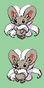

# No.0573 奇诺栗鼠

奇诺栗鼠#0573

一般

<table class="ib-t"><tr><th>全国图鉴号</th><td>0573</td></tr><tr><th>分类</th><td>围巾</td></tr><tr><th>种族值合计</th><td>470</td></tr><tr><th>成长率</th><td>快</td></tr><tr><th>蛋组</th><td>场地</td></tr><tr><th>雌性比例</th><td>无性别差异</td></tr><tr><th>捕获率</th><td>60</td></tr><tr><th>基础亲密</th><td>70（标准）</td></tr></table>

<a href="#stats">种族值</a><a href="#matchup">相性</a><a href="#ability">特性</a><a href="#moves">招式池</a><a href="#forms">形态</a>

奇诺栗鼠的身上覆盖着特别的油脂，可以卸掉拳击等来自对手的攻击。

## 种族值 {#stats}

<table class="statbar-t">
<tr><th>HP</th><td class="num">75</td><td>
<i style="width:38%;background:#63bb63"></i>
</td></tr>
<tr><th>攻击</th><td class="num">95</td><td>
<i style="width:48%;background:#e0b93c"></i>
</td></tr>
<tr><th>防御</th><td class="num">60</td><td>
<i style="width:30%;background:#d2794a"></i>
</td></tr>
<tr><th>特攻</th><td class="num">65</td><td>
<i style="width:32%;background:#45b8c8"></i>
</td></tr>
<tr><th>特防</th><td class="num">60</td><td>
<i style="width:30%;background:#5b7dc6"></i>
</td></tr>
<tr><th>速度</th><td class="num">115</td><td>
<i style="width:57%;background:#b467c4"></i>
</td></tr>
<tr class="total"><th>总和</th><td class="num">470</td><td>
<i style="width:100%;background:#8a97a8"></i>
</td></tr>
</table>

## 相性（防守侧） {#matchup}

| 倍率 | 攻击属性 |
|---|---|
| **2×** | 格斗 |
| **1×** | 一般 冰 地面 岩石 恶 毒 水 火 电 草 虫 超能力 钢 飞行 龙 |
| **免疫** | 幽灵 |

## 特性 {#ability}

| 槽位 | 特性 | 游戏内描述 |
|:---|:---|:---|
| 第一特性 | **[迷人之躯](../abilities/迷人之躯.md)** | 有时会让接触到的对手着迷 |
| 第二特性 | **[技术高手](../abilities/技术高手.md)** | 强化低威力的招式 |
| 隐藏特性 | **[连续攻击](../abilities/连续攻击.md)** | 连续招式总能使出最高次数 |

## 招式池 {#moves}

本作可通过回忆系统获得的**全部合法招式**，共 **77** 个（按招式编号序）。

展开查看全部 77 个合法招式

拍击、连环巴掌、摔打、猛撞、舍身冲撞、摇尾巴、叫声、唱歌、破坏光线、十万伏特、电磁波、打雷、挖洞、剧毒、影子分身、光墙、高速星星、睡觉、愤怒门牙、替身、小偷、打鼾、抓狂、守住、掷泥、挺住、撒娇、虚张声势、迷人、梦话、报恩、迁怒、神秘守护、接棒、再来一次、铁尾、觉醒力量、求雨、大晴天、吵闹、硬撑、帮助、拍落、蛮干、秘密之力、巨声、假哭、挠痒、种子机关枪、渴望、冥想、岩石爆击、电击波、唤醒巴掌、急速折返、投掷、珍藏、水流尾、种子炸弹、真气弹、终极冲击、垃圾射击、诱惑、打草结、您先请、轮唱、回声、报仇、自我激励、扫尾拍打、密语、磨砺、三旋击、冰旋、大扫除、起草、泼冷水

## 形态 {#forms}

无（本编号在本作只有一个可用形态）

<a href="../0572-泡沫栗鼠/">← #0572 泡沫栗鼠</a>
<a href="../">图鉴目录</a>
<a href="../0574-哥德宝宝/">#0574 哥德宝宝 →</a>

