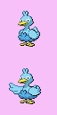

# No.0580 鸭宝宝

鸭宝宝#0580

水 飞行

<table class="ib-t"><tr><th>全国图鉴号</th><td>0580</td></tr><tr><th>分类</th><td>水鸟</td></tr><tr><th>种族值合计</th><td>305</td></tr><tr><th>成长率</th><td>中快</td></tr><tr><th>蛋组</th><td>水中1 · 飞行</td></tr><tr><th>雌性比例</th><td>无性别差异</td></tr><tr><th>捕获率</th><td>190</td></tr><tr><th>基础亲密</th><td>70（标准）</td></tr></table>

<a href="#stats">种族值</a><a href="#matchup">相性</a><a href="#ability">特性</a><a href="#moves">招式池</a><a href="#forms">形态</a>

比起飞行，更擅长游泳。会潜入水中，开心地吃非常喜欢的水青苔。

## 种族值 {#stats}

<table class="statbar-t">
<tr><th>HP</th><td class="num">62</td><td>
<i style="width:31%;background:#63bb63"></i>
</td></tr>
<tr><th>攻击</th><td class="num">44</td><td>
<i style="width:22%;background:#e0b93c"></i>
</td></tr>
<tr><th>防御</th><td class="num">50</td><td>
<i style="width:25%;background:#d2794a"></i>
</td></tr>
<tr><th>特攻</th><td class="num">44</td><td>
<i style="width:22%;background:#45b8c8"></i>
</td></tr>
<tr><th>特防</th><td class="num">50</td><td>
<i style="width:25%;background:#5b7dc6"></i>
</td></tr>
<tr><th>速度</th><td class="num">55</td><td>
<i style="width:28%;background:#b467c4"></i>
</td></tr>
<tr class="total"><th>总和</th><td class="num">305</td><td>
<i style="width:100%;background:#8a97a8"></i>
</td></tr>
</table>

## 相性（防守侧） {#matchup}

| 倍率 | 攻击属性 |
|---|---|
| **4×** | 电 |
| **2×** | 岩石 |
| **1×** | 一般 冰 幽灵 恶 毒 草 超能力 飞行 龙 |
| **1/2×** | 格斗 水 火 虫 钢 |
| **免疫** | 地面 |

## 特性 {#ability}

| 槽位 | 特性 | 游戏内描述 |
|:---|:---|:---|
| 第一特性 | **[锐利目光](../abilities/锐利目光.md)** | 命中率不会被降低 |
| 第二特性 | **[健壮胸肌](../abilities/健壮胸肌.md)** | 不会受到防御降低的效果 |
| 隐藏特性 | **[湿润之躯](../abilities/湿润之躯.md)** | 下雨天气时治愈异常状态 |

## 招式池 {#moves}

本作可通过回忆系统获得的**全部合法招式**，共 **58** 个（按招式编号序）。

展开查看全部 58 个合法招式

起风、翅膀攻击、飞翔、舍身冲撞、水枪、冲浪、冰冻光束、泡沫光线、剧毒、影子分身、鹦鹉学舌、高速星星、睡觉、替身、打鼾、守住、冰冻之风、挺住、虚张声势、钢翼、迷人、梦话、报恩、迁怒、觉醒力量、求雨、潮旋、吵闹、冰雹、硬撑、帮助、蛮干、秘密之力、潜水、羽毛舞、玩泥巴、空气利刃、燕返、玩水、水之波动、羽栖、盐水、啄食、顺风、幸运咒语、抢先一步、水流环、空气之刃、勇鸟猛攻、清除浓雾、水流喷射、轮唱、热水、暴风、密语、水流裂破、起草、泼冷水

## 形态 {#forms}

无（本编号在本作只有一个可用形态）

<a href="../0579-人造细胞卵/">← #0579 人造细胞卵</a>
<a href="../">图鉴目录</a>
<a href="../0581-舞天鹅/">#0581 舞天鹅 →</a>

