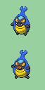

# No.0588 盖盖虫

盖盖虫#0588

虫

<table class="ib-t"><tr><th>全国图鉴号</th><td>0588</td></tr><tr><th>分类</th><td>啃咬</td></tr><tr><th>种族值合计</th><td>315</td></tr><tr><th>成长率</th><td>中快</td></tr><tr><th>蛋组</th><td>虫</td></tr><tr><th>雌性比例</th><td>无性别差异</td></tr><tr><th>捕获率</th><td>200</td></tr><tr><th>基础亲密</th><td>70（标准）</td></tr></table>

<a href="#stats">种族值</a><a href="#matchup">相性</a><a href="#ability">特性</a><a href="#moves">招式池</a><a href="#forms">形态</a>

袭击小嘴蜗时，如果沐浴在电能下，不知为何就会进化。

## 种族值 {#stats}

<table class="statbar-t">
<tr><th>HP</th><td class="num">50</td><td>
<i style="width:25%;background:#63bb63"></i>
</td></tr>
<tr><th>攻击</th><td class="num">75</td><td>
<i style="width:38%;background:#e0b93c"></i>
</td></tr>
<tr><th>防御</th><td class="num">45</td><td>
<i style="width:22%;background:#d2794a"></i>
</td></tr>
<tr><th>特攻</th><td class="num">40</td><td>
<i style="width:20%;background:#45b8c8"></i>
</td></tr>
<tr><th>特防</th><td class="num">45</td><td>
<i style="width:22%;background:#5b7dc6"></i>
</td></tr>
<tr><th>速度</th><td class="num">60</td><td>
<i style="width:30%;background:#b467c4"></i>
</td></tr>
<tr class="total"><th>总和</th><td class="num">315</td><td>
<i style="width:100%;background:#8a97a8"></i>
</td></tr>
</table>

## 相性（防守侧） {#matchup}

| 倍率 | 攻击属性 |
|---|---|
| **2×** | 岩石 火 飞行 |
| **1×** | 一般 冰 幽灵 恶 毒 水 电 虫 超能力 钢 龙 |
| **1/2×** | 地面 格斗 草 |

## 特性 {#ability}

| 槽位 | 特性 | 游戏内描述 |
|:---|:---|:---|
| 第一特性 | **[虫之预感](../abilities/虫之预感.md)** | HP低时强化虫属性招式 |
| 第二特性 | **[蜕皮](../abilities/蜕皮.md)** | 有时会治愈异常状态 |
| 隐藏特性 | **[无防守](../abilities/无防守.md)** | 双方的招式都必定会击中 |

## 招式池 {#moves}

本作可通过回忆系统获得的**全部合法招式**，共 **57** 个（按招式编号序）。

展开查看全部 57 个合法招式

剑舞、居合劈、头锤、角撞、乱击、泰山压顶、猛撞、舍身冲撞、瞪眼、溶解液、啄、双倍奉还、超级吸取、剧毒、刺耳声、影子分身、睡觉、劈开、替身、打鼾、抓狂、守住、可怕面孔、终极吸取、挺住、点到为止、虚张声势、连斩、迷人、梦话、报恩、迁怒、超级角击、接棒、再来一次、追打、觉醒力量、求雨、硬撑、哈欠、拍落、秘密之力、信号光束、燕返、铁壁、毒击、暗袭要害、十字剪、虫鸣、能量球、虫咬、酸液炸弹、轮唱、虫之抵抗、直冲钻、密语、纠缠不休

## 形态 {#forms}

无（本编号在本作只有一个可用形态）

<a href="../0587-电飞鼠/">← #0587 电飞鼠</a>
<a href="../">图鉴目录</a>
<a href="../0589-骑士蜗牛/">#0589 骑士蜗牛 →</a>

