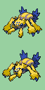

# No.0596 电蜘蛛

电蜘蛛#0596

虫 电

<table class="ib-t"><tr><th>全国图鉴号</th><td>0596</td></tr><tr><th>分类</th><td>电蜘蛛</td></tr><tr><th>种族值合计</th><td>472</td></tr><tr><th>成长率</th><td>中快</td></tr><tr><th>蛋组</th><td>虫</td></tr><tr><th>雌性比例</th><td>无性别差异</td></tr><tr><th>捕获率</th><td>75</td></tr><tr><th>基础亲密</th><td>70（标准）</td></tr></table>

<a href="#stats">种族值</a><a href="#matchup">相性</a><a href="#ability">特性</a><a href="#moves">招式池</a><a href="#forms">形态</a>

被敌人袭击的话，会吐出大量带电的丝，制作成电的屏障。

## 种族值 {#stats}

<table class="statbar-t">
<tr><th>HP</th><td class="num">70</td><td>
<i style="width:35%;background:#63bb63"></i>
</td></tr>
<tr><th>攻击</th><td class="num">77</td><td>
<i style="width:38%;background:#e0b93c"></i>
</td></tr>
<tr><th>防御</th><td class="num">60</td><td>
<i style="width:30%;background:#d2794a"></i>
</td></tr>
<tr><th>特攻</th><td class="num">97</td><td>
<i style="width:48%;background:#45b8c8"></i>
</td></tr>
<tr><th>特防</th><td class="num">60</td><td>
<i style="width:30%;background:#5b7dc6"></i>
</td></tr>
<tr><th>速度</th><td class="num">108</td><td>
<i style="width:54%;background:#b467c4"></i>
</td></tr>
<tr class="total"><th>总和</th><td class="num">472</td><td>
<i style="width:100%;background:#8a97a8"></i>
</td></tr>
</table>

## 相性（防守侧） {#matchup}

| 倍率 | 攻击属性 |
|---|---|
| **2×** | 岩石 火 |
| **1×** | 一般 冰 地面 幽灵 恶 毒 水 虫 超能力 飞行 龙 |
| **1/2×** | 格斗 电 草 钢 |

## 特性 {#ability}

| 槽位 | 特性 | 游戏内描述 |
|:---|:---|:---|
| 第一特性 | **[复眼](../abilities/复眼.md)** | 招式的命中率会提高 |
| 第二特性 | **[紧张感](../abilities/紧张感.md)** | 让对手紧张得无法食用树果 |
| 隐藏特性 | **[虫之预感](../abilities/虫之预感.md)** | HP低时强化虫属性招式 |

## 招式池 {#moves}

本作可通过回忆系统获得的**全部合法招式**，共 **71** 个（按招式编号序）。

展开查看全部 71 个合法招式

居合劈、毒针、飞弹针、定身法、破坏光线、吸取、吐丝、十万伏特、电磁波、打雷、剧毒、高速移动、刺耳声、影子分身、光墙、高速星星、汲取、闪光、睡觉、劈开、替身、小偷、蛛网、打鼾、守住、终极吸取、挺住、虚张声势、连斩、迷人、梦话、报恩、迁怒、追打、觉醒力量、求雨、硬撑、充电、帮助、秘密之力、保护色、信号光束、弹跳、电击波、胃液、突袭、电磁飘浮、毒击、十字剪、虫鸣、能量球、终极冲击、攀岩、放电、十字毒刃、虫咬、充电光束、电球、轮唱、伏特替换、虫之抵抗、电网、疯狂伏特、黏黏网、密语、纠缠不休、深渊突刺、猛扑、速度互换、爬击、虫扑

## 形态 {#forms}

无（本编号在本作只有一个可用形态）

<a href="../0595-电电虫/">← #0595 电电虫</a>
<a href="../">图鉴目录</a>
<a href="../0597-种子铁球/">#0597 种子铁球 →</a>

