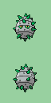

# No.0597 种子铁球

种子铁球#0597

草 钢

<table class="ib-t"><tr><th>全国图鉴号</th><td>0597</td></tr><tr><th>分类</th><td>刺果</td></tr><tr><th>种族值合计</th><td>305</td></tr><tr><th>成长率</th><td>中快</td></tr><tr><th>蛋组</th><td>植物 · 矿物</td></tr><tr><th>雌性比例</th><td>无性别差异</td></tr><tr><th>捕获率</th><td>255</td></tr><tr><th>基础亲密</th><td>70（标准）</td></tr></table>

<a href="#stats">种族值</a><a href="#matchup">相性</a><a href="#ability">特性</a><a href="#moves">招式池</a><a href="#forms">形态</a>

刺入洞顶，吸取岩石中的铁质。当危险逼近，就会射出尖刺。

## 种族值 {#stats}

<table class="statbar-t">
<tr><th>HP</th><td class="num">44</td><td>
<i style="width:22%;background:#63bb63"></i>
</td></tr>
<tr><th>攻击</th><td class="num">50</td><td>
<i style="width:25%;background:#e0b93c"></i>
</td></tr>
<tr><th>防御</th><td class="num">91</td><td>
<i style="width:46%;background:#d2794a"></i>
</td></tr>
<tr><th>特攻</th><td class="num">24</td><td>
<i style="width:12%;background:#45b8c8"></i>
</td></tr>
<tr><th>特防</th><td class="num">86</td><td>
<i style="width:43%;background:#5b7dc6"></i>
</td></tr>
<tr><th>速度</th><td class="num">10</td><td>
<i style="width:5%;background:#b467c4"></i>
</td></tr>
<tr class="total"><th>总和</th><td class="num">305</td><td>
<i style="width:100%;background:#8a97a8"></i>
</td></tr>
</table>

## 相性（防守侧） {#matchup}

| 倍率 | 攻击属性 |
|---|---|
| **4×** | 火 |
| **2×** | 格斗 |
| **1×** | 冰 地面 虫 飞行 |
| **1/2×** | 一般 岩石 幽灵 恶 水 电 超能力 钢 龙 |
| **1/4×** | 草 |
| **免疫** | 毒 |

## 特性 {#ability}

| 槽位 | 特性 | 游戏内描述 |
|:---|:---|:---|
| 第一特性 | **[铁刺](../abilities/铁刺.md)** | 用铁刺给予接触的对手伤害 |

## 招式池 {#moves}

本作可通过回忆系统获得的**全部合法招式**，共 **59** 个（按招式编号序）。

展开查看全部 59 个合法招式

撞击、飞弹针、寄生种子、日光束、十万伏特、电磁波、剧毒、影子分身、变硬、玉石俱碎、闪光、大爆炸、睡觉、替身、打鼾、咒术、守住、撒菱、终极吸取、挺住、滚动、虚张声势、迷人、梦话、报恩、迁怒、金属爪、觉醒力量、大晴天、碎岩、硬撑、自然之力、扎根、报复、拍落、蛮干、秘密之力、种子机关枪、铁壁、重力、陀螺球、以牙还牙、恶意追击、烦恼种子、电磁飘浮、岩石打磨、毒击、种子炸弹、能量球、镜光射击、加农光炮、攀岩、铁头、隐形岩、磨爪、酸液炸弹、轮唱、密语、铁蹄光线

## 形态 {#forms}

无（本编号在本作只有一个可用形态）

<a href="../0596-电蜘蛛/">← #0596 电蜘蛛</a>
<a href="../">图鉴目录</a>
<a href="../0598-坚果哑铃/">#0598 坚果哑铃 →</a>

