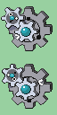

# No.0600 齿轮组

齿轮组#0600

钢

<table class="ib-t"><tr><th>全国图鉴号</th><td>0600</td></tr><tr><th>分类</th><td>齿轮</td></tr><tr><th>种族值合计</th><td>440</td></tr><tr><th>成长率</th><td>中慢</td></tr><tr><th>蛋组</th><td>矿物</td></tr><tr><th>雌性比例</th><td>无性别差异</td></tr><tr><th>捕获率</th><td>60</td></tr><tr><th>基础亲密</th><td>70（标准）</td></tr></table>

<a href="#stats">种族值</a><a href="#matchup">相性</a><a href="#ability">特性</a><a href="#moves">招式池</a><a href="#forms">形态</a>

身体分为大齿轮和小齿轮。如果攻击时发射出去的小齿轮回不来的话，就会死去。

## 种族值 {#stats}

<table class="statbar-t">
<tr><th>HP</th><td class="num">60</td><td>
<i style="width:30%;background:#63bb63"></i>
</td></tr>
<tr><th>攻击</th><td class="num">80</td><td>
<i style="width:40%;background:#e0b93c"></i>
</td></tr>
<tr><th>防御</th><td class="num">95</td><td>
<i style="width:48%;background:#d2794a"></i>
</td></tr>
<tr><th>特攻</th><td class="num">70</td><td>
<i style="width:35%;background:#45b8c8"></i>
</td></tr>
<tr><th>特防</th><td class="num">85</td><td>
<i style="width:42%;background:#5b7dc6"></i>
</td></tr>
<tr><th>速度</th><td class="num">50</td><td>
<i style="width:25%;background:#b467c4"></i>
</td></tr>
<tr class="total"><th>总和</th><td class="num">440</td><td>
<i style="width:100%;background:#8a97a8"></i>
</td></tr>
</table>

## 相性（防守侧） {#matchup}

| 倍率 | 攻击属性 |
|---|---|
| **2×** | 地面 格斗 火 |
| **1×** | 水 电 |
| **1/2×** | 一般 冰 岩石 幽灵 恶 草 虫 超能力 钢 飞行 龙 |
| **免疫** | 毒 |

## 特性 {#ability}

| 槽位 | 特性 | 游戏内描述 |
|:---|:---|:---|
| 第一特性 | **[正电](../abilities/正电.md)** | 场上有同类特性会提高特攻 |
| 第二特性 | **[负电](../abilities/负电.md)** | 场上有同类特性会提高特攻 |
| 隐藏特性 | **[恒净之躯](../abilities/恒净之躯.md)** | 不会因为对手而被降低能力 |

## 招式池 {#moves}

本作可通过回忆系统获得的**全部合法招式**，共 **51** 个（按招式编号序）。

展开查看全部 51 个合法招式

绑紧、破坏光线、电击、十万伏特、电磁波、剧毒、刺耳声、影子分身、睡觉、替身、打鼾、守住、电磁炮、锁定、沙暴、挺住、虚张声势、梦话、报恩、迁怒、觉醒力量、碎岩、吵闹、硬撑、充电、魔法反射、回收利用、秘密之力、金属音、信号光束、铁壁、电击波、重力、恶意追击、电磁飘浮、岩石打磨、力量宝石、镜光射击、加农光炮、放电、充电光束、身体轻量化、意念移物、轮唱、交换场地、换档、伏特替换、疯狂伏特、齿轮飞盘、密语、铁蹄光线

## 形态 {#forms}

无（本编号在本作只有一个可用形态）

<a href="../0599-齿轮儿/">← #0599 齿轮儿</a>
<a href="../">图鉴目录</a>
<a href="../0601-齿轮怪/">#0601 齿轮怪 →</a>

