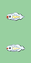

# No.0602 麻麻小鱼

麻麻小鱼#0602

电

<table class="ib-t"><tr><th>全国图鉴号</th><td>0602</td></tr><tr><th>分类</th><td>电鱼</td></tr><tr><th>种族值合计</th><td>275</td></tr><tr><th>成长率</th><td>慢</td></tr><tr><th>蛋组</th><td>不定形</td></tr><tr><th>雌性比例</th><td>无性别差异</td></tr><tr><th>捕获率</th><td>190</td></tr><tr><th>基础亲密</th><td>70（标准）</td></tr></table>

<a href="#stats">种族值</a><a href="#matchup">相性</a><a href="#ability">特性</a><a href="#moves">招式池</a><a href="#forms">形态</a>

1条的电力虽小，但是许多麻麻小鱼聚在一起，其威力可以比得上雷电。

## 种族值 {#stats}

<table class="statbar-t">
<tr><th>HP</th><td class="num">35</td><td>
<i style="width:18%;background:#63bb63"></i>
</td></tr>
<tr><th>攻击</th><td class="num">55</td><td>
<i style="width:28%;background:#e0b93c"></i>
</td></tr>
<tr><th>防御</th><td class="num">40</td><td>
<i style="width:20%;background:#d2794a"></i>
</td></tr>
<tr><th>特攻</th><td class="num">45</td><td>
<i style="width:22%;background:#45b8c8"></i>
</td></tr>
<tr><th>特防</th><td class="num">40</td><td>
<i style="width:20%;background:#5b7dc6"></i>
</td></tr>
<tr><th>速度</th><td class="num">60</td><td>
<i style="width:30%;background:#b467c4"></i>
</td></tr>
<tr class="total"><th>总和</th><td class="num">275</td><td>
<i style="width:100%;background:#8a97a8"></i>
</td></tr>
</table>

## 相性（防守侧） {#matchup}

| 倍率 | 攻击属性 |
|---|---|
| **2×** | 地面 |
| **1×** | 一般 冰 岩石 幽灵 恶 格斗 毒 水 火 草 虫 超能力 龙 |
| **1/2×** | 电 钢 飞行 |

## 特性 {#ability}

| 槽位 | 特性 | 游戏内描述 |
|:---|:---|:---|
| 第一特性 | **[飘浮](../abilities/飘浮.md)** | 不会受地面属性招式攻击 |

## 招式池 {#moves}

本作可通过回忆系统获得的**全部合法招式**，共 **9** 个（按招式编号序）。

展开查看全部 9 个合法招式

撞击、电磁波、守住、电光、硬撑、充电、拍落、电磁飘浮、充电光束

## 形态 {#forms}

无（本编号在本作只有一个可用形态）

<a href="../0601-齿轮怪/">← #0601 齿轮怪</a>
<a href="../">图鉴目录</a>
<a href="../0603-麻麻鳗/">#0603 麻麻鳗 →</a>

