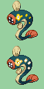

# No.0603 麻麻鳗

麻麻鳗#0603

电

<table class="ib-t"><tr><th>全国图鉴号</th><td>0603</td></tr><tr><th>分类</th><td>电鱼</td></tr><tr><th>种族值合计</th><td>405</td></tr><tr><th>成长率</th><td>慢</td></tr><tr><th>蛋组</th><td>不定形</td></tr><tr><th>雌性比例</th><td>无性别差异</td></tr><tr><th>捕获率</th><td>60</td></tr><tr><th>基础亲密</th><td>70（标准）</td></tr></table>

<a href="#stats">种族值</a><a href="#matchup">相性</a><a href="#ability">特性</a><a href="#moves">招式池</a><a href="#forms">形态</a>

是食欲旺盛的宝可梦。一旦发现猎物就会发动袭击，将对方用电麻痹后再吃掉。

## 种族值 {#stats}

<table class="statbar-t">
<tr><th>HP</th><td class="num">65</td><td>
<i style="width:32%;background:#63bb63"></i>
</td></tr>
<tr><th>攻击</th><td class="num">85</td><td>
<i style="width:42%;background:#e0b93c"></i>
</td></tr>
<tr><th>防御</th><td class="num">70</td><td>
<i style="width:35%;background:#d2794a"></i>
</td></tr>
<tr><th>特攻</th><td class="num">75</td><td>
<i style="width:38%;background:#45b8c8"></i>
</td></tr>
<tr><th>特防</th><td class="num">70</td><td>
<i style="width:35%;background:#5b7dc6"></i>
</td></tr>
<tr><th>速度</th><td class="num">40</td><td>
<i style="width:20%;background:#b467c4"></i>
</td></tr>
<tr class="total"><th>总和</th><td class="num">405</td><td>
<i style="width:100%;background:#8a97a8"></i>
</td></tr>
</table>

## 相性（防守侧） {#matchup}

| 倍率 | 攻击属性 |
|---|---|
| **2×** | 地面 |
| **1×** | 一般 冰 岩石 幽灵 恶 格斗 毒 水 火 草 虫 超能力 龙 |
| **1/2×** | 电 钢 飞行 |

## 特性 {#ability}

| 槽位 | 特性 | 游戏内描述 |
|:---|:---|:---|
| 第一特性 | **[飘浮](../abilities/飘浮.md)** | 不会受地面属性招式攻击 |

## 招式池 {#moves}

本作可通过回忆系统获得的**全部合法招式**，共 **61** 个（按招式编号序）。

展开查看全部 61 个合法招式

绑紧、头锤、撞击、泰山压顶、猛撞、大闹一番、溶解液、十万伏特、电磁波、打雷、剧毒、影子分身、光墙、闪光、睡觉、愤怒门牙、替身、打鼾、守住、可怕面孔、电磁炮、终极吸取、挺住、虚张声势、电光、迷人、梦话、报恩、迁怒、铁尾、觉醒力量、求雨、咬碎、硬撑、充电、拍落、秘密之力、信号光束、弹跳、电击波、急速折返、胃液、电磁飘浮、水流尾、雷电牙、加农光炮、放电、充电光束、电球、盘蜷、酸液炸弹、轮唱、杂技、伏特替换、电网、疯狂伏特、密语、怪异电波、电气场地、深渊突刺、猛扑

## 形态 {#forms}

无（本编号在本作只有一个可用形态）

<a href="../0602-麻麻小鱼/">← #0602 麻麻小鱼</a>
<a href="../">图鉴目录</a>
<a href="../0604-麻麻鳗鱼王/">#0604 麻麻鳗鱼王 →</a>

