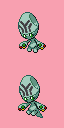

# No.0605 小灰怪

小灰怪#0605

超能力

<table class="ib-t"><tr><th>全国图鉴号</th><td>0605</td></tr><tr><th>分类</th><td>脑</td></tr><tr><th>种族值合计</th><td>335</td></tr><tr><th>成长率</th><td>中快</td></tr><tr><th>蛋组</th><td>人型</td></tr><tr><th>雌性比例</th><td>无性别差异</td></tr><tr><th>捕获率</th><td>255</td></tr><tr><th>基础亲密</th><td>70（标准）</td></tr></table>

<a href="#stats">种族值</a><a href="#matchup">相性</a><a href="#ability">特性</a><a href="#moves">招式池</a><a href="#forms">形态</a>

据说它是来自于传闻50年前有UFO坠落的沙漠里。

## 种族值 {#stats}

<table class="statbar-t">
<tr><th>HP</th><td class="num">55</td><td>
<i style="width:28%;background:#63bb63"></i>
</td></tr>
<tr><th>攻击</th><td class="num">55</td><td>
<i style="width:28%;background:#e0b93c"></i>
</td></tr>
<tr><th>防御</th><td class="num">55</td><td>
<i style="width:28%;background:#d2794a"></i>
</td></tr>
<tr><th>特攻</th><td class="num">85</td><td>
<i style="width:42%;background:#45b8c8"></i>
</td></tr>
<tr><th>特防</th><td class="num">55</td><td>
<i style="width:28%;background:#5b7dc6"></i>
</td></tr>
<tr><th>速度</th><td class="num">30</td><td>
<i style="width:15%;background:#b467c4"></i>
</td></tr>
<tr class="total"><th>总和</th><td class="num">335</td><td>
<i style="width:100%;background:#8a97a8"></i>
</td></tr>
</table>

## 相性（防守侧） {#matchup}

| 倍率 | 攻击属性 |
|---|---|
| **2×** | 幽灵 恶 虫 |
| **1×** | 一般 冰 地面 岩石 毒 水 火 电 草 钢 飞行 龙 |
| **1/2×** | 格斗 超能力 |

## 特性 {#ability}

| 槽位 | 特性 | 游戏内描述 |
|:---|:---|:---|
| 第一特性 | **[心灵感应](../abilities/心灵感应.md)** | 闪避己方的招式伤害 |
| 第二特性 | **[同步](../abilities/同步.md)** | 将自己异常状态传染给对手 |
| 隐藏特性 | **[分析](../abilities/分析.md)** | 在最后使出招式时威力提高 |

## 招式池 {#moves}

本作可通过回忆系统获得的**全部合法招式**，共 **81** 个（按招式编号序）。

展开查看全部 81 个合法招式

头锤、叫声、定身法、幻象光线、十万伏特、电磁波、剧毒、念力、精神强念、高速移动、瞬间移动、刺耳声、影子分身、自我再生、屏障、光墙、反射壁、食梦、闪光、睡觉、岩崩、替身、小偷、打鼾、守住、同命、挺住、虚张声势、钢翼、迷人、梦话、报恩、迁怒、神秘守护、分担痛楚、觉醒力量、求雨、自我暗示、暗影球、吵闹、硬撑、戏法、扮演、魔法反射、回收利用、特性互换、封印、化为己用、秘密之力、惊吓、岩石封锁、宇宙力量、信号光束、冥想、电击波、重力、奇迹之眼、查封、回复封锁、力量互换、防守互换、恶之波动、能量球、诡计、意念头锤、戏法空间、充电光束、防守平分、力量平分、奇妙空间、精神冲击、意念移物、同步干扰、单纯光束、您先请、轮唱、回声、辅助力量、交换场地、密语、流星光束

## 形态 {#forms}

无（本编号在本作只有一个可用形态）

<a href="../0604-麻麻鳗鱼王/">← #0604 麻麻鳗鱼王</a>
<a href="../">图鉴目录</a>
<a href="../0606-大宇怪/">#0606 大宇怪 →</a>

