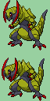

# No.0612 双斧战龙

双斧战龙#0612

龙

<table class="ib-t"><tr><th>全国图鉴号</th><td>0612</td></tr><tr><th>分类</th><td>颚斧</td></tr><tr><th>种族值合计</th><td>540</td></tr><tr><th>成长率</th><td>慢</td></tr><tr><th>蛋组</th><td>怪兽 · 龙</td></tr><tr><th>雌性比例</th><td>无性别差异</td></tr><tr><th>捕获率</th><td>45</td></tr><tr><th>基础亲密</th><td>35</td></tr></table>

<a href="#stats">种族值</a><a href="#matchup">相性</a><a href="#ability">特性</a><a href="#moves">招式池</a><a href="#forms">形态</a>

有着即使切斩工字钢也不会伤刃的坚固牙齿。全身被坚硬的铠甲覆盖着。

## 种族值 {#stats}

<table class="statbar-t">
<tr><th>HP</th><td class="num">76</td><td>
<i style="width:38%;background:#63bb63"></i>
</td></tr>
<tr><th>攻击</th><td class="num">147</td><td>
<i style="width:74%;background:#e0b93c"></i>
</td></tr>
<tr><th>防御</th><td class="num">90</td><td>
<i style="width:45%;background:#d2794a"></i>
</td></tr>
<tr><th>特攻</th><td class="num">60</td><td>
<i style="width:30%;background:#45b8c8"></i>
</td></tr>
<tr><th>特防</th><td class="num">70</td><td>
<i style="width:35%;background:#5b7dc6"></i>
</td></tr>
<tr><th>速度</th><td class="num">97</td><td>
<i style="width:48%;background:#b467c4"></i>
</td></tr>
<tr class="total"><th>总和</th><td class="num">540</td><td>
<i style="width:100%;background:#8a97a8"></i>
</td></tr>
</table>

## 相性（防守侧） {#matchup}

| 倍率 | 攻击属性 |
|---|---|
| **2×** | 冰 龙 |
| **1×** | 一般 地面 岩石 幽灵 恶 格斗 毒 虫 超能力 钢 飞行 |
| **1/2×** | 水 火 电 草 |

## 特性 {#ability}

| 槽位 | 特性 | 游戏内描述 |
|:---|:---|:---|
| 第一特性 | **[斗争心](../abilities/斗争心.md)** | 对同性别对手变强反之变弱 |
| 第二特性 | **[破格](../abilities/破格.md)** | 使用招式不受对手特性影响 |
| 隐藏特性 | **[紧张感](../abilities/紧张感.md)** | 让对手紧张得无法食用树果 |

## 招式池 {#moves}

本作可通过回忆系统获得的**全部合法招式**，共 **90** 个（按招式编号序）。

展开查看全部 90 个合法招式

抓、极落钳、旋风刀、剑舞、居合劈、泰山压顶、猛撞、舍身冲撞、瞪眼、咬住、吼叫、冲浪、破坏光线、踢倒、双倍奉还、怪力、龙之怒、地震、挖洞、剧毒、影子分身、变硬、聚气、高速星星、睡觉、岩崩、劈开、替身、打鼾、绝处逢生、守住、可怕面孔、逆鳞、挺住、点到为止、虚张声势、迷人、梦话、报恩、迁怒、铁尾、觉醒力量、求雨、大晴天、咬碎、碎岩、硬撑、挑衅、蛮力、劈瓦、蛮干、秘密之力、岩石封锁、燕返、龙爪、龙之舞、电击波、近身战、以牙还牙、恶意追击、投掷、毒击、暗袭要害、水流尾、十字剪、龙之波动、真气弹、终极冲击、暗影爪、精神利刃、流星群、铁头、打草结、磨爪、下盘踢、轮唱、烧净、重踏、龙尾、二连劈、大声咆哮、密语、迎头一击、磨砺、狂舞挥打、跺脚、广域破坏、鳞射、起草、龙声鼓舞

## 形态 {#forms}

无（本编号在本作只有一个可用形态）

<a href="../0611-斧牙龙/">← #0611 斧牙龙</a>
<a href="../">图鉴目录</a>
<a href="../0613-喷嚏熊/">#0613 喷嚏熊 →</a>

