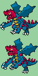

# No.0621 赤面龙

赤面龙#0621

龙

<table class="ib-t"><tr><th>全国图鉴号</th><td>0621</td></tr><tr><th>分类</th><td>洞穴</td></tr><tr><th>种族值合计</th><td>485</td></tr><tr><th>成长率</th><td>中快</td></tr><tr><th>蛋组</th><td>龙 · 怪兽</td></tr><tr><th>雌性比例</th><td>无性别差异</td></tr><tr><th>捕获率</th><td>45</td></tr><tr><th>基础亲密</th><td>70（标准）</td></tr></table>

<a href="#stats">种族值</a><a href="#matchup">相性</a><a href="#ability">特性</a><a href="#moves">招式池</a><a href="#forms">形态</a>

用翅膀接收阳光，温暖身体。如果体温下降就会变得无法动弹。

## 种族值 {#stats}

<table class="statbar-t">
<tr><th>HP</th><td class="num">77</td><td>
<i style="width:38%;background:#63bb63"></i>
</td></tr>
<tr><th>攻击</th><td class="num">120</td><td>
<i style="width:60%;background:#e0b93c"></i>
</td></tr>
<tr><th>防御</th><td class="num">90</td><td>
<i style="width:45%;background:#d2794a"></i>
</td></tr>
<tr><th>特攻</th><td class="num">60</td><td>
<i style="width:30%;background:#45b8c8"></i>
</td></tr>
<tr><th>特防</th><td class="num">90</td><td>
<i style="width:45%;background:#5b7dc6"></i>
</td></tr>
<tr><th>速度</th><td class="num">48</td><td>
<i style="width:24%;background:#b467c4"></i>
</td></tr>
<tr class="total"><th>总和</th><td class="num">485</td><td>
<i style="width:100%;background:#8a97a8"></i>
</td></tr>
</table>

## 相性（防守侧） {#matchup}

| 倍率 | 攻击属性 |
|---|---|
| **2×** | 冰 龙 |
| **1×** | 一般 地面 岩石 幽灵 恶 格斗 毒 虫 超能力 钢 飞行 |
| **1/2×** | 水 火 电 草 |

## 特性 {#ability}

| 槽位 | 特性 | 游戏内描述 |
|:---|:---|:---|
| 第一特性 | **[粗糙皮肤](../abilities/粗糙皮肤.md)** | 受到攻击时弄伤接触的对手 |
| 第二特性 | **[强行](../abilities/强行.md)** | 消除追加效果以强化招式 |
| 隐藏特性 | **[破格](../abilities/破格.md)** | 使用招式不受对手特性影响 |

## 招式池 {#moves}

本作可通过回忆系统获得的**全部合法招式**，共 **90** 个（按招式编号序）。

展开查看全部 90 个合法招式

百万吨重拳、火焰拳、雷电拳、抓、居合劈、泰山压顶、瞪眼、咬住、吼叫、喷射火焰、冲浪、破坏光线、怪力、龙之怒、地震、挖洞、剧毒、影子分身、大蛇瞪眼、睡觉、岩崩、劈开、替身、打鼾、守住、可怕面孔、污泥炸弹、逆鳞、挺住、虚张声势、迷人、梦话、报恩、迁怒、追打、铁尾、金属爪、觉醒力量、求雨、大晴天、咬碎、碎岩、热风、无理取闹、硬撑、挑衅、蛮力、报复、化为己用、秘密之力、撕裂爪、岩石封锁、燕返、龙爪、毒尾、电击波、以牙还牙、投掷、突袭、恶之波动、暗袭要害、水流尾、龙之波动、真气弹、终极冲击、暗影爪、雷电牙、火焰牙、加农光炮、攀岩、流星群、垃圾射击、铁头、隐形岩、充电光束、磨爪、击落、轮唱、逐步击破、烧净、报仇、重踏、龙尾、大声咆哮、密语、增强拳、跺脚、鳞射、泄愤、双翼

## 形态 {#forms}

无（本编号在本作只有一个可用形态）

<a href="../0620-师父鼬/">← #0620 师父鼬</a>
<a href="../">图鉴目录</a>
<a href="../0622-泥偶小人/">#0622 泥偶小人 →</a>

