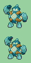

# No.0622 泥偶小人

泥偶小人#0622

地面 幽灵

<table class="ib-t"><tr><th>全国图鉴号</th><td>0622</td></tr><tr><th>分类</th><td>魔像</td></tr><tr><th>种族值合计</th><td>303</td></tr><tr><th>成长率</th><td>中快</td></tr><tr><th>蛋组</th><td>矿物</td></tr><tr><th>雌性比例</th><td>无性别差异</td></tr><tr><th>捕获率</th><td>190</td></tr><tr><th>基础亲密</th><td>70（标准）</td></tr></table>

<a href="#stats">种族值</a><a href="#matchup">相性</a><a href="#ability">特性</a><a href="#moves">招式池</a><a href="#forms">形态</a>

根据古代的科学力量由黏土制成的宝可梦。能持续活动数千年。

## 种族值 {#stats}

<table class="statbar-t">
<tr><th>HP</th><td class="num">59</td><td>
<i style="width:30%;background:#63bb63"></i>
</td></tr>
<tr><th>攻击</th><td class="num">74</td><td>
<i style="width:37%;background:#e0b93c"></i>
</td></tr>
<tr><th>防御</th><td class="num">50</td><td>
<i style="width:25%;background:#d2794a"></i>
</td></tr>
<tr><th>特攻</th><td class="num">35</td><td>
<i style="width:18%;background:#45b8c8"></i>
</td></tr>
<tr><th>特防</th><td class="num">50</td><td>
<i style="width:25%;background:#5b7dc6"></i>
</td></tr>
<tr><th>速度</th><td class="num">35</td><td>
<i style="width:18%;background:#b467c4"></i>
</td></tr>
<tr class="total"><th>总和</th><td class="num">303</td><td>
<i style="width:100%;background:#8a97a8"></i>
</td></tr>
</table>

## 相性（防守侧） {#matchup}

| 倍率 | 攻击属性 |
|---|---|
| **2×** | 冰 幽灵 恶 水 草 |
| **1×** | 地面 火 超能力 钢 飞行 龙 |
| **1/2×** | 岩石 虫 |
| **1/4×** | 毒 |
| **免疫** | 一般 格斗 电 |

## 特性 {#ability}

| 槽位 | 特性 | 游戏内描述 |
|:---|:---|:---|
| 第一特性 | **[铁拳](../abilities/铁拳.md)** | 使用拳类招式的威力会提高 |
| 第二特性 | **[笨拙](../abilities/笨拙.md)** | 无法使用持有的道具 |
| 隐藏特性 | **[无防守](../abilities/无防守.md)** | 双方的招式都必定会击中 |

## 招式池 {#moves}

本作可通过回忆系统获得的**全部合法招式**，共 **95** 个（按招式编号序）。

展开查看全部 95 个合法招式

拍击、连续拳、百万吨重拳、火焰拳、冰冻拳、雷电拳、百万吨重踢、撞击、泰山压顶、猛撞、舍身冲撞、冰冻光束、破坏光线、踢倒、怪力、地震、挖洞、剧毒、精神强念、黑夜魔影、影子分身、变硬、奇异之光、变圆、反射壁、玉石俱碎、闪光、睡觉、岩崩、替身、小偷、打鼾、咒术、守住、掷泥、冰冻之风、沙暴、挺住、滚动、虚张声势、梦话、报恩、迁怒、神秘守护、震级、爆裂拳、觉醒力量、求雨、大晴天、自我暗示、暗影球、碎岩、硬撑、真气拳、帮助、蛮力、魔法反射、劈瓦、拍落、封印、秘密之力、惊吓、岩石封锁、信号光束、暗影拳、铁壁、挡路、泥巴射击、电击波、重力、臂锤、陀螺球、投掷、岩石打磨、吸取拳、真气弹、大地之力、铁头、磁铁炸弹、隐形岩、打草结、意念移物、击落、重磅冲撞、下盘踢、轮唱、交换场地、祸不单行、重踏、潜灵奇袭、密语、增强拳、跺脚、灵骚、热沙大地

## 形态 {#forms}

无（本编号在本作只有一个可用形态）

<a href="../0621-赤面龙/">← #0621 赤面龙</a>
<a href="../">图鉴目录</a>
<a href="../0623-泥偶巨人/">#0623 泥偶巨人 →</a>

