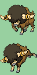

# No.0626 爆炸头水牛

爆炸头水牛#0626

一般

<table class="ib-t"><tr><th>全国图鉴号</th><td>0626</td></tr><tr><th>分类</th><td>头锤牛</td></tr><tr><th>种族值合计</th><td>490</td></tr><tr><th>成长率</th><td>中快</td></tr><tr><th>蛋组</th><td>场地</td></tr><tr><th>雌性比例</th><td>无性别差异</td></tr><tr><th>捕获率</th><td>45</td></tr><tr><th>基础亲密</th><td>70（标准）</td></tr></table>

<a href="#stats">种族值</a><a href="#matchup">相性</a><a href="#ability">特性</a><a href="#moves">招式池</a><a href="#forms">形态</a>

即使使出猛烈的头锤，蓬松的体毛也会将伤害都吸收掉。

## 种族值 {#stats}

<table class="statbar-t">
<tr><th>HP</th><td class="num">95</td><td>
<i style="width:48%;background:#63bb63"></i>
</td></tr>
<tr><th>攻击</th><td class="num">110</td><td>
<i style="width:55%;background:#e0b93c"></i>
</td></tr>
<tr><th>防御</th><td class="num">95</td><td>
<i style="width:48%;background:#d2794a"></i>
</td></tr>
<tr><th>特攻</th><td class="num">40</td><td>
<i style="width:20%;background:#45b8c8"></i>
</td></tr>
<tr><th>特防</th><td class="num">95</td><td>
<i style="width:48%;background:#5b7dc6"></i>
</td></tr>
<tr><th>速度</th><td class="num">55</td><td>
<i style="width:28%;background:#b467c4"></i>
</td></tr>
<tr class="total"><th>总和</th><td class="num">490</td><td>
<i style="width:100%;background:#8a97a8"></i>
</td></tr>
</table>

## 相性（防守侧） {#matchup}

| 倍率 | 攻击属性 |
|---|---|
| **2×** | 格斗 |
| **1×** | 一般 冰 地面 岩石 恶 毒 水 火 电 草 虫 超能力 钢 飞行 龙 |
| **免疫** | 幽灵 |

## 特性 {#ability}

| 槽位 | 特性 | 游戏内描述 |
|:---|:---|:---|
| 第一特性 | **[舍身](../abilities/舍身.md)** | 强化有反作用力伤害的招式 |
| 第二特性 | **[食草](../abilities/食草.md)** | 免疫草属性攻击并提高攻击 |
| 隐藏特性 | **[隔音](../abilities/隔音.md)** | 不受到声音招式的影响 |

## 招式池 {#moves}

本作可通过回忆系统获得的**全部合法招式**，共 **73** 个（按招式编号序）。

展开查看全部 73 个合法招式

剑舞、居合劈、踩踏、头锤、角撞、乱击、撞击、泰山压顶、大闹一番、瞪眼、冲浪、怪力、地震、剧毒、愤怒、影子分身、聚气、火箭头锤、瞬间失忆、睡觉、岩崩、替身、打鼾、绝处逢生、守住、可怕面孔、掷泥、逆鳞、挺住、虚张声势、迷人、梦话、报恩、迁怒、超级角击、追打、觉醒力量、求雨、大晴天、碎岩、吵闹、硬撑、挑衅、蛮力、报复、蛮干、秘密之力、岩石封锁、燕返、泥巴射击、近身战、以牙还牙、恶意追击、毒击、终极冲击、意念头锤、攀岩、铁头、尖石攻击、轮唱、报仇、重踏、自我激励、疯狂伏特、棉花防守、爆炸头突击、打嗝、密语、十万马力、深渊突刺、修长之角、跺脚、泄愤

## 形态 {#forms}

无（本编号在本作只有一个可用形态）

<a href="../0625-劈斩司令/">← #0625 劈斩司令</a>
<a href="../">图鉴目录</a>
<a href="../0627-毛头小鹰/">#0627 毛头小鹰 →</a>

