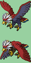

# No.0628 勇士雄鹰

勇士雄鹰#0628

一般 飞行

<table class="ib-t"><tr><th>全国图鉴号</th><td>0628</td></tr><tr><th>分类</th><td>勇猛</td></tr><tr><th>种族值合计</th><td>510</td></tr><tr><th>成长率</th><td>慢</td></tr><tr><th>蛋组</th><td>飞行</td></tr><tr><th>雌性比例</th><td>无性别差异</td></tr><tr><th>捕获率</th><td>60</td></tr><tr><th>基础亲密</th><td>70（标准）</td></tr></table>

<a href="#stats">种族值</a><a href="#matchup">相性</a><a href="#ability">特性</a><a href="#moves">招式池</a><a href="#forms">形态</a>

为了伙伴的话，无论受多重的伤都不会放弃战斗，是勇敢的天空战士。

## 种族值 {#stats}

<table class="statbar-t">
<tr><th>HP</th><td class="num">100</td><td>
<i style="width:50%;background:#63bb63"></i>
</td></tr>
<tr><th>攻击</th><td class="num">123</td><td>
<i style="width:62%;background:#e0b93c"></i>
</td></tr>
<tr><th>防御</th><td class="num">75</td><td>
<i style="width:38%;background:#d2794a"></i>
</td></tr>
<tr><th>特攻</th><td class="num">57</td><td>
<i style="width:28%;background:#45b8c8"></i>
</td></tr>
<tr><th>特防</th><td class="num">75</td><td>
<i style="width:38%;background:#5b7dc6"></i>
</td></tr>
<tr><th>速度</th><td class="num">80</td><td>
<i style="width:40%;background:#b467c4"></i>
</td></tr>
<tr class="total"><th>总和</th><td class="num">510</td><td>
<i style="width:100%;background:#8a97a8"></i>
</td></tr>
</table>

## 相性（防守侧） {#matchup}

| 倍率 | 攻击属性 |
|---|---|
| **2×** | 冰 岩石 电 |
| **1×** | 一般 恶 格斗 毒 水 火 超能力 钢 飞行 龙 |
| **1/2×** | 草 虫 |
| **免疫** | 地面 幽灵 |

## 特性 {#ability}

| 槽位 | 特性 | 游戏内描述 |
|:---|:---|:---|
| 第一特性 | **[锐利目光](../abilities/锐利目光.md)** | 命中率不会被降低 |
| 第二特性 | **[强行](../abilities/强行.md)** | 消除追加效果以强化招式 |
| 隐藏特性 | **[不服输](../abilities/不服输.md)** | 被降低能力时大幅提高攻击 |

## 招式池 {#moves}

本作可通过回忆系统获得的**全部合法招式**，共 **73** 个（按招式编号序）。

展开查看全部 73 个合法招式

居合劈、翅膀攻击、吹飞、飞翔、乱击、泰山压顶、猛撞、大闹一番、舍身冲撞、瞪眼、破坏光线、啄、怪力、剧毒、高速移动、影子分身、高速星星、神鸟猛击、睡觉、岩崩、劈开、替身、打鼾、绝处逢生、守住、可怕面孔、挺住、虚张声势、钢翼、迷人、梦话、报恩、迁怒、金属爪、觉醒力量、求雨、大晴天、碎岩、热风、硬撑、帮助、蛮力、秘密之力、羽毛舞、撕裂爪、空气利刃、岩石封锁、燕返、健美、羽栖、啄食、顺风、急速折返、近身战、恶意追击、空气之刃、勇鸟猛攻、终极冲击、暗影爪、意念头锤、清除浓雾、铁头、磨爪、轮唱、自由落体、杂技、报仇、自我激励、暴风、密语、磨砺、双翼、暗影之刃

## 形态 {#forms}

无（本编号在本作只有一个可用形态）

<a href="../0627-毛头小鹰/">← #0627 毛头小鹰</a>
<a href="../">图鉴目录</a>
<a href="../0629-秃鹰丫头/">#0629 秃鹰丫头 →</a>

