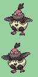

# No.0629 秃鹰丫头

秃鹰丫头#0629

恶 飞行

<table class="ib-t"><tr><th>全国图鉴号</th><td>0629</td></tr><tr><th>分类</th><td>尿布</td></tr><tr><th>种族值合计</th><td>370</td></tr><tr><th>成长率</th><td>慢</td></tr><tr><th>蛋组</th><td>飞行</td></tr><tr><th>雌性比例</th><td>无性别差异</td></tr><tr><th>捕获率</th><td>190</td></tr><tr><th>基础亲密</th><td>35</td></tr></table>

<a href="#stats">种族值</a><a href="#matchup">相性</a><a href="#ability">特性</a><a href="#moves">招式池</a><a href="#forms">形态</a>

翅膀很小，还不能飞。用秃鹰娜收集来的骸骨保护着臀部。

## 种族值 {#stats}

<table class="statbar-t">
<tr><th>HP</th><td class="num">70</td><td>
<i style="width:35%;background:#63bb63"></i>
</td></tr>
<tr><th>攻击</th><td class="num">55</td><td>
<i style="width:28%;background:#e0b93c"></i>
</td></tr>
<tr><th>防御</th><td class="num">75</td><td>
<i style="width:38%;background:#d2794a"></i>
</td></tr>
<tr><th>特攻</th><td class="num">45</td><td>
<i style="width:22%;background:#45b8c8"></i>
</td></tr>
<tr><th>特防</th><td class="num">65</td><td>
<i style="width:32%;background:#5b7dc6"></i>
</td></tr>
<tr><th>速度</th><td class="num">60</td><td>
<i style="width:30%;background:#b467c4"></i>
</td></tr>
<tr class="total"><th>总和</th><td class="num">370</td><td>
<i style="width:100%;background:#8a97a8"></i>
</td></tr>
</table>

## 相性（防守侧） {#matchup}

| 倍率 | 攻击属性 |
|---|---|
| **2×** | 冰 岩石 电 |
| **1×** | 一般 格斗 毒 水 火 虫 钢 飞行 龙 |
| **1/2×** | 幽灵 恶 草 |
| **免疫** | 地面 超能力 |

## 特性 {#ability}

| 槽位 | 特性 | 游戏内描述 |
|:---|:---|:---|
| 第一特性 | **[健壮胸肌](../abilities/健壮胸肌.md)** | 不会受到防御降低的效果 |
| 第二特性 | **[防尘](../abilities/防尘.md)** | 无视沙暴与粉末或孢子招式 |
| 隐藏特性 | **[碎裂铠甲](../abilities/碎裂铠甲.md)** | 受物理攻击降防御提高速度 |

## 招式池 {#moves}

本作可通过回忆系统获得的**全部合法招式**，共 **72** 个（按招式编号序）。

展开查看全部 72 个合法招式

居合劈、起风、吹飞、飞翔、乱击、猛撞、舍身冲撞、瞪眼、剧毒、影子分身、鹦鹉学舌、高速星星、睡觉、替身、小偷、打鼾、怨恨、守住、可怕面孔、出奇一击、挺住、虚张声势、钢翼、黑色目光、迷人、梦话、报恩、迁怒、觉醒力量、求雨、大晴天、自我暗示、暗影球、碎岩、吵闹、热风、无理取闹、吹捧、硬撑、挑衅、拍落、化为己用、秘密之力、羽毛舞、假哭、空气利刃、岩石封锁、燕返、铁壁、挡路、羽栖、啄食、顺风、急速折返、以牙还牙、恶意追击、查封、惩罚、恶之波动、空气之刃、勇鸟猛攻、诡计、清除浓雾、移花接木、轮唱、烧净、报仇、大声咆哮、密语、深渊突刺、泄愤、双翼

## 形态 {#forms}

无（本编号在本作只有一个可用形态）

<a href="../0628-勇士雄鹰/">← #0628 勇士雄鹰</a>
<a href="../">图鉴目录</a>
<a href="../0630-秃鹰娜/">#0630 秃鹰娜 →</a>

