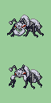

# No.0632 铁蚁

铁蚁#0632

虫 钢

<table class="ib-t"><tr><th>全国图鉴号</th><td>0632</td></tr><tr><th>分类</th><td>铁蚁</td></tr><tr><th>种族值合计</th><td>484</td></tr><tr><th>成长率</th><td>中快</td></tr><tr><th>蛋组</th><td>虫</td></tr><tr><th>雌性比例</th><td>无性别差异</td></tr><tr><th>捕获率</th><td>90</td></tr><tr><th>基础亲密</th><td>70（标准）</td></tr></table>

<a href="#stats">种族值</a><a href="#matchup">相性</a><a href="#ability">特性</a><a href="#moves">招式池</a><a href="#forms">形态</a>

身上裹着钢铁的铠甲。以群体之力防御并反击天敌熔蚁兽的攻击。

## 种族值 {#stats}

<table class="statbar-t">
<tr><th>HP</th><td class="num">58</td><td>
<i style="width:29%;background:#63bb63"></i>
</td></tr>
<tr><th>攻击</th><td class="num">109</td><td>
<i style="width:55%;background:#e0b93c"></i>
</td></tr>
<tr><th>防御</th><td class="num">112</td><td>
<i style="width:56%;background:#d2794a"></i>
</td></tr>
<tr><th>特攻</th><td class="num">48</td><td>
<i style="width:24%;background:#45b8c8"></i>
</td></tr>
<tr><th>特防</th><td class="num">48</td><td>
<i style="width:24%;background:#5b7dc6"></i>
</td></tr>
<tr><th>速度</th><td class="num">109</td><td>
<i style="width:55%;background:#b467c4"></i>
</td></tr>
<tr class="total"><th>总和</th><td class="num">484</td><td>
<i style="width:100%;background:#8a97a8"></i>
</td></tr>
</table>

## 相性（防守侧） {#matchup}

| 倍率 | 攻击属性 |
|---|---|
| **4×** | 火 |
| **1×** | 地面 岩石 格斗 水 电 飞行 |
| **1/2×** | 一般 冰 幽灵 恶 虫 超能力 钢 龙 |
| **1/4×** | 草 |
| **免疫** | 毒 |

## 特性 {#ability}

| 槽位 | 特性 | 游戏内描述 |
|:---|:---|:---|
| 第一特性 | **[虫之预感](../abilities/虫之预感.md)** | HP低时强化虫属性招式 |
| 第二特性 | **[活力](../abilities/活力.md)** | 攻击变高，但命中率会降低 |
| 隐藏特性 | **[懒惰](../abilities/懒惰.md)** | 每隔一回合就会休息，可以偷个懒 |

## 招式池 {#moves}

本作可通过回忆系统获得的**全部合法招式**，共 **63** 个（按招式编号序）。

展开查看全部 63 个合法招式

极落钳、居合劈、泼沙、咬住、怪力、电磁波、挖洞、剧毒、高速移动、刺耳声、影子分身、睡觉、岩崩、替身、打鼾、抓狂、守住、沙暴、挺住、虚张声势、连斩、迷人、梦话、报恩、迁怒、接棒、金属爪、觉醒力量、咬碎、碎岩、围攻、硬撑、帮助、蛮力、蛮干、秘密之力、岩石封锁、金属音、燕返、铁壁、金属爆炸、岩石打磨、十字剪、能量球、终极冲击、暗影爪、雷电牙、加农光炮、攀岩、铁头、尖石攻击、虫咬、磨爪、找伙伴、轮唱、报仇、虫之抵抗、密语、纠缠不休、迎头一击、跺脚、铁蹄光线、爬击

## 形态 {#forms}

无（本编号在本作只有一个可用形态）

<a href="../0631-熔蚁兽/">← #0631 熔蚁兽</a>
<a href="../">图鉴目录</a>
<a href="../0633-单首龙/">#0633 单首龙 →</a>

