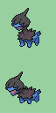

# No.0633 单首龙

单首龙#0633

恶 龙

<table class="ib-t"><tr><th>全国图鉴号</th><td>0633</td></tr><tr><th>分类</th><td>粗鲁</td></tr><tr><th>种族值合计</th><td>300</td></tr><tr><th>成长率</th><td>慢</td></tr><tr><th>蛋组</th><td>龙</td></tr><tr><th>雌性比例</th><td>无性别差异</td></tr><tr><th>捕获率</th><td>45</td></tr><tr><th>基础亲密</th><td>35</td></tr></table>

<a href="#stats">种族值</a><a href="#matchup">相性</a><a href="#ability">特性</a><a href="#moves">招式池</a><a href="#forms">形态</a>

因为不了解周围的情形，所以会不断地到处乱撞，撞到活物时就咬住吃。

## 种族值 {#stats}

<table class="statbar-t">
<tr><th>HP</th><td class="num">52</td><td>
<i style="width:26%;background:#63bb63"></i>
</td></tr>
<tr><th>攻击</th><td class="num">65</td><td>
<i style="width:32%;background:#e0b93c"></i>
</td></tr>
<tr><th>防御</th><td class="num">50</td><td>
<i style="width:25%;background:#d2794a"></i>
</td></tr>
<tr><th>特攻</th><td class="num">45</td><td>
<i style="width:22%;background:#45b8c8"></i>
</td></tr>
<tr><th>特防</th><td class="num">50</td><td>
<i style="width:25%;background:#5b7dc6"></i>
</td></tr>
<tr><th>速度</th><td class="num">38</td><td>
<i style="width:19%;background:#b467c4"></i>
</td></tr>
<tr class="total"><th>总和</th><td class="num">300</td><td>
<i style="width:100%;background:#8a97a8"></i>
</td></tr>
</table>

## 相性（防守侧） {#matchup}

| 倍率 | 攻击属性 |
|---|---|
| **2×** | 冰 格斗 虫 龙 |
| **1×** | 一般 地面 岩石 毒 钢 飞行 |
| **1/2×** | 幽灵 恶 水 火 电 草 |
| **免疫** | 超能力 |

## 特性 {#ability}

| 槽位 | 特性 | 游戏内描述 |
|:---|:---|:---|
| 第一特性 | **[活力](../abilities/活力.md)** | 攻击变高，但命中率会降低 |

## 招式池 {#moves}

本作可通过回忆系统获得的**全部合法招式**，共 **68** 个（按招式编号序）。

展开查看全部 68 个合法招式

摔打、头锤、撞击、泰山压顶、猛撞、咬住、吼叫、喷射火焰、怪力、龙之怒、电磁波、剧毒、刺耳声、影子分身、聚气、睡觉、替身、小偷、打鼾、怨恨、守住、可怕面孔、逆鳞、挺住、虚张声势、迷人、梦话、报恩、迁怒、龙息、觉醒力量、求雨、大晴天、咬碎、自我暗示、碎岩、吵闹、无理取闹、硬撑、挑衅、蛮力、秘密之力、巨声、惊吓、电击波、恶意追击、恶之波动、水流尾、龙之波动、龙之俯冲、真气弹、大地之力、诡计、雷电牙、冰冻牙、火焰牙、意念头锤、流星群、双刃头锤、二连击、轮唱、烧净、龙尾、自我激励、大声咆哮、打嗝、密语、龙声鼓舞

## 形态 {#forms}

无（本编号在本作只有一个可用形态）

<a href="../0632-铁蚁/">← #0632 铁蚁</a>
<a href="../">图鉴目录</a>
<a href="../0634-双首暴龙/">#0634 双首暴龙 →</a>

