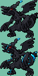

# No.0644 捷克罗姆

捷克罗姆#0644

电 龙

<table class="ib-t"><tr><th>全国图鉴号</th><td>0644</td></tr><tr><th>分类</th><td>黑阴</td></tr><tr><th>种族值合计</th><td>680</td></tr><tr><th>成长率</th><td>慢</td></tr><tr><th>蛋组</th><td>未发现</td></tr><tr><th>雌性比例</th><td>无性别差异</td></tr><tr><th>捕获率</th><td>3</td></tr><tr><th>基础亲密</th><td>0</td></tr></table>

<a href="#stats">种族值</a><a href="#matchup">相性</a><a href="#ability">特性</a><a href="#moves">招式池</a><a href="#forms">形态</a>

用尾巴制造出电。把全身隐藏在雷云里，在合众地区的空中飞行。

## 种族值 {#stats}

<table class="statbar-t">
<tr><th>HP</th><td class="num">100</td><td>
<i style="width:50%;background:#63bb63"></i>
</td></tr>
<tr><th>攻击</th><td class="num">150</td><td>
<i style="width:75%;background:#e0b93c"></i>
</td></tr>
<tr><th>防御</th><td class="num">120</td><td>
<i style="width:60%;background:#d2794a"></i>
</td></tr>
<tr><th>特攻</th><td class="num">120</td><td>
<i style="width:60%;background:#45b8c8"></i>
</td></tr>
<tr><th>特防</th><td class="num">100</td><td>
<i style="width:50%;background:#5b7dc6"></i>
</td></tr>
<tr><th>速度</th><td class="num">90</td><td>
<i style="width:45%;background:#b467c4"></i>
</td></tr>
<tr class="total"><th>总和</th><td class="num">680</td><td>
<i style="width:100%;background:#8a97a8"></i>
</td></tr>
</table>

## 相性（防守侧） {#matchup}

| 倍率 | 攻击属性 |
|---|---|
| **2×** | 冰 地面 龙 |
| **1×** | 一般 岩石 幽灵 恶 格斗 毒 虫 超能力 |
| **1/2×** | 水 火 草 钢 飞行 |
| **1/4×** | 电 |

## 特性 {#ability}

| 槽位 | 特性 | 游戏内描述 |
|:---|:---|:---|
| 第一特性 | **[兆级电压](../abilities/兆级电压.md)** | 使用招式不受对手特性影响 |

## 招式池 {#moves}

本作可通过回忆系统获得的**全部合法招式**，共 **96** 个（按招式编号序）。

展开查看全部 96 个合法招式

雷电拳、居合劈、飞翔、泰山压顶、猛撞、舍身冲撞、吼叫、破坏光线、怪力、龙之怒、十万伏特、电磁波、打雷、剧毒、精神强念、影子分身、光墙、黑雾、反射壁、高速星星、闪光、睡觉、岩崩、劈开、替身、打鼾、守住、可怕面孔、逆鳞、挺住、虚张声势、钢翼、梦话、报恩、迁怒、神秘守护、龙息、觉醒力量、求雨、大晴天、咬碎、原始之力、暗影球、碎岩、硬撑、真气拳、充电、帮助、劈瓦、封印、秘密之力、巨声、气象球、岩石封锁、信号光束、龙爪、龙之舞、电击波、羽栖、顺风、以牙还牙、投掷、电磁飘浮、龙之波动、真气弹、大地之力、终极冲击、暗影爪、雷电牙、意念头锤、加农光炮、清除浓雾、流星群、尖石攻击、隐形岩、充电光束、磨爪、电球、轮唱、回声、伏特替换、龙尾、疯狂伏特、雷击、交错闪电、战吼、密语、电气场地、磨砺、狂舞挥打、扑击、广域破坏、鳞射、双翼、龙声鼓舞、闪电强袭

## 形态 {#forms}

无（本编号在本作只有一个可用形态）

<a href="../0643-莱希拉姆/">← #0643 莱希拉姆</a>
<a href="../">图鉴目录</a>
<a href="../0645-土地云/">#0645 土地云 →</a>

