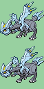

# No.0646 酋雷姆

酋雷姆#0646

冰 龙

<table class="ib-t"><tr><th>全国图鉴号</th><td>0646</td></tr><tr><th>分类</th><td>境界</td></tr><tr><th>种族值合计</th><td>660</td></tr><tr><th>成长率</th><td>慢</td></tr><tr><th>蛋组</th><td>未发现</td></tr><tr><th>雌性比例</th><td>无性别差异</td></tr><tr><th>捕获率</th><td>3</td></tr><tr><th>基础亲密</th><td>0</td></tr></table>

<a href="#stats">种族值</a><a href="#matchup">相性</a><a href="#ability">特性</a><a href="#moves">招式池</a><a href="#forms">形态</a>

在体内制造出强力的冰冻能量，但身体因为泄漏的冷气而冻住了。

## 种族值 {#stats}

<table class="statbar-t">
<tr><th>HP</th><td class="num">125</td><td>
<i style="width:62%;background:#63bb63"></i>
</td></tr>
<tr><th>攻击</th><td class="num">130</td><td>
<i style="width:65%;background:#e0b93c"></i>
</td></tr>
<tr><th>防御</th><td class="num">90</td><td>
<i style="width:45%;background:#d2794a"></i>
</td></tr>
<tr><th>特攻</th><td class="num">130</td><td>
<i style="width:65%;background:#45b8c8"></i>
</td></tr>
<tr><th>特防</th><td class="num">90</td><td>
<i style="width:45%;background:#5b7dc6"></i>
</td></tr>
<tr><th>速度</th><td class="num">95</td><td>
<i style="width:48%;background:#b467c4"></i>
</td></tr>
<tr class="total"><th>总和</th><td class="num">660</td><td>
<i style="width:100%;background:#8a97a8"></i>
</td></tr>
</table>

## 相性（防守侧） {#matchup}

| 倍率 | 攻击属性 |
|---|---|
| **2×** | 岩石 格斗 钢 龙 |
| **1×** | 一般 冰 地面 幽灵 恶 毒 火 虫 超能力 飞行 |
| **1/2×** | 水 电 草 |

## 特性 {#ability}

| 槽位 | 特性 | 游戏内描述 |
|:---|:---|:---|
| 第一特性 | **[压迫感](../abilities/压迫感.md)** | 减少对手使用招式的PP |

## 招式池 {#moves}

本作可通过回忆系统获得的**全部合法招式**，共 **86** 个（按招式编号序）。

展开查看全部 86 个合法招式

居合劈、飞翔、泰山压顶、猛撞、吼叫、冰冻光束、暴风雪、破坏光线、怪力、龙之怒、剧毒、精神强念、影子分身、光墙、反射壁、高速星星、睡觉、岩崩、劈开、替身、打鼾、守住、可怕面孔、冰冻之风、逆鳞、挺住、虚张声势、钢翼、梦话、报恩、迁怒、神秘守护、龙息、觉醒力量、求雨、大晴天、原始之力、暗影球、碎岩、冰雹、硬撑、帮助、蛮干、封印、秘密之力、巨声、气象球、岩石封锁、信号光束、绝对零度、燕返、冰锥、龙爪、龙之舞、羽栖、以牙还牙、投掷、龙之波动、真气弹、大地之力、终极冲击、雪崩、暗影爪、冰冻牙、意念头锤、加农光炮、流星群、铁头、尖石攻击、磨爪、轮唱、回声、龙尾、冰封世界、战吼、冷冻干燥、密语、磨砺、狂舞挥打、扑击、广域破坏、鳞射、双翼、雪景、龙声鼓舞、极寒冰刺

## 形态 {#forms}

无（本编号在本作只有一个可用形态）

<a href="../0645-土地云/">← #0645 土地云</a>
<a href="../">图鉴目录</a>
<a href="../0647-凯路迪欧/">#0647 凯路迪欧 →</a>

