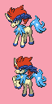

# No.0647 凯路迪欧

凯路迪欧#0647

水 格斗

<table class="ib-t"><tr><th>全国图鉴号</th><td>0647</td></tr><tr><th>分类</th><td>幼马</td></tr><tr><th>种族值合计</th><td>580</td></tr><tr><th>成长率</th><td>慢</td></tr><tr><th>蛋组</th><td>未发现</td></tr><tr><th>雌性比例</th><td>无性别差异</td></tr><tr><th>捕获率</th><td>3</td></tr><tr><th>基础亲密</th><td>35</td></tr></table>

<a href="#stats">种族值</a><a href="#matchup">相性</a><a href="#ability">特性</a><a href="#moves">招式池</a><a href="#forms">形态</a>

据说当它挺过了艰难的战斗，额头上的角就能得到锻炼，从而激发出自己真正的力量。

## 种族值 {#stats}

<table class="statbar-t">
<tr><th>HP</th><td class="num">91</td><td>
<i style="width:46%;background:#63bb63"></i>
</td></tr>
<tr><th>攻击</th><td class="num">72</td><td>
<i style="width:36%;background:#e0b93c"></i>
</td></tr>
<tr><th>防御</th><td class="num">90</td><td>
<i style="width:45%;background:#d2794a"></i>
</td></tr>
<tr><th>特攻</th><td class="num">129</td><td>
<i style="width:64%;background:#45b8c8"></i>
</td></tr>
<tr><th>特防</th><td class="num">90</td><td>
<i style="width:45%;background:#5b7dc6"></i>
</td></tr>
<tr><th>速度</th><td class="num">108</td><td>
<i style="width:54%;background:#b467c4"></i>
</td></tr>
<tr class="total"><th>总和</th><td class="num">580</td><td>
<i style="width:100%;background:#8a97a8"></i>
</td></tr>
</table>

## 相性（防守侧） {#matchup}

| 倍率 | 攻击属性 |
|---|---|
| **2×** | 电 草 超能力 飞行 |
| **1×** | 一般 地面 幽灵 格斗 毒 龙 |
| **1/2×** | 冰 岩石 恶 水 火 虫 钢 |

## 特性 {#ability}

| 槽位 | 特性 | 游戏内描述 |
|:---|:---|:---|
| 第一特性 | **[正义之心](../abilities/正义之心.md)** | 受恶属性攻击时提高攻击 |

## 招式池 {#moves}

本作可通过回忆系统获得的**全部合法招式**，共 **90** 个（按招式编号序）。

展开查看全部 90 个合法招式

剑舞、居合劈、二连踢、头锤、泰山压顶、猛撞、舍身冲撞、瞪眼、吼叫、水炮、冲浪、冰冻光束、泡沫光线、破坏光线、踢倒、怪力、剧毒、影子分身、光墙、反射壁、攀瀑、高速星星、火箭头锤、睡觉、替身、打鼾、绝处逢生、守住、冰冻之风、挺住、点到为止、虚张声势、梦话、报恩、迁怒、神秘守护、分担痛楚、超级角击、接棒、觉醒力量、求雨、大晴天、自我暗示、碎岩、潮旋、冰雹、硬撑、挑衅、帮助、蛮力、报复、劈瓦、蛮干、秘密之力、浊流、燕返、弹跳、渴望、冥想、水之波动、近身战、珍藏、波导弹、毒击、水流尾、空气之刃、十字剪、真空波、真气弹、大地之力、终极冲击、意念头锤、尖石攻击、隐形岩、水流喷射、轮唱、快速防守、热水、报仇、自我激励、圣剑、神秘之剑、密语、修长之角、水流裂破、指导、快速折返、起草、泼冷水、快手还击

## 形态 {#forms}

无（本编号在本作只有一个可用形态）

<a href="../0646-酋雷姆/">← #0646 酋雷姆</a>
<a href="../">图鉴目录</a>
<a href="../0648-美洛耶塔/">#0648 美洛耶塔 →</a>

